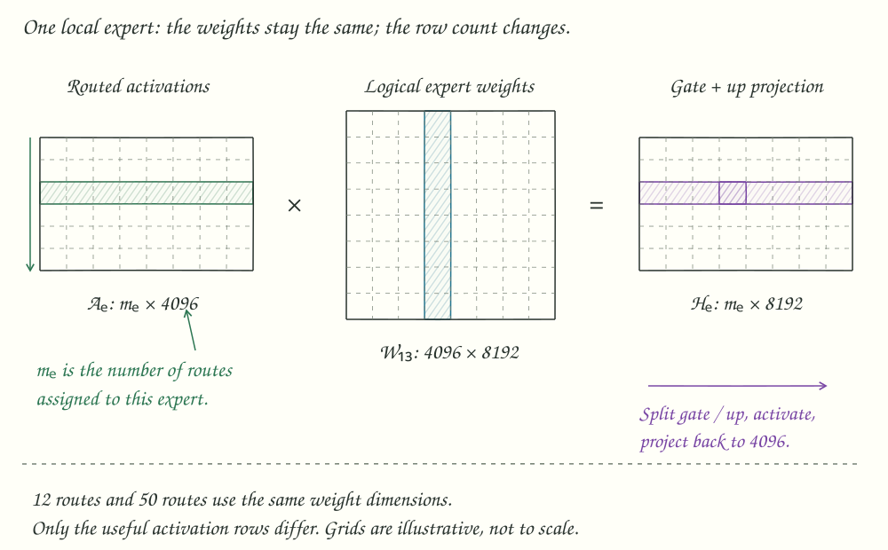
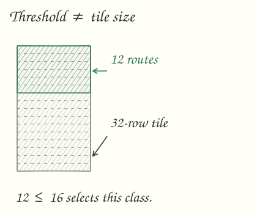
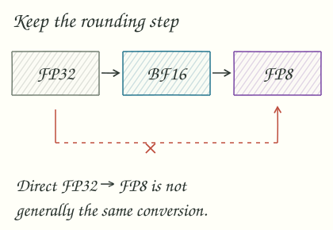

## Two extra heads, one changed byte {#starting-point}

I added value-cache stores to a query/key preparation kernel. The normalization formula stayed the same. Yet one query element that stock produced as **0.8125** became **0.875**.

The extra work changed the row count used to choose a GPU launch tile. That changed how the compiler grouped floating-point additions. A tiny rounding difference became a different FP8 byte. Fixing the first failing inputs was not enough: a wider sweep found another failure, and the final repair needed a stock fallback.

This was the most useful lesson from my Open Kernel Challenge serving project. I began with expert scheduling, then tried attention-preparation fusion. The **best observed aggregate score was 1.0251×** against unmodified SGLang. Repaired attention fusion passed official evaluation at **1.0224×**, but these separate runs did not establish an incremental performance benefit.

<aside class="sidenote"><strong>About the work</strong> I ran this project with coding and research agents. They investigated source, implemented changes, ran probes and reviewed results; I directed the project and made the final risk decision. The independent reviewer mentioned below was a separate research agent. This article describes that collaboration.</aside>

To explain the bug, I need to start with the server and the earlier scheduling work. Both optimizations tried to remove work around existing kernels. Attention fusion also had to preserve rounded values written into persistent cache state.

## The server I started with {#system}

The reference system—called **stock** throughout this article—served Muse Spark Open with SGLang v0.5.23 at commit `297e54fd` on **eight H200 GPUs**. It used NVFP4 quantized weights, an FP8 key/value cache, tensor parallelism and expert parallelism across eight ranks, and DFlash speculative decoding with an eight-token block. The official scored run evaluated 1, 4, 16 and 32 concurrent users. [1](#ref-contract)

<aside class="sidenote"><strong>A rank is one participating process</strong> Here there is one per GPU. Tensor parallelism divides tensor operations across ranks; expert parallelism assigns different experts to different ranks. NVFP4, BF16 and FP8 refer to numerical representations, not different model architectures.</aside>

First, **prefill** processes the prompt and builds its key/value cache. During generation, the draft model proposes tokens; the larger target model checks them in a **verification** step. Accepted tokens advance the conversation, while the cache and other state must remain consistent with the accepted sequence. Inside each target step, attention reads cached history and the mixture-of-experts layers process routed activations. That is the loop I was optimizing. [2](#ref-system)

<figure><figcaption>One pass through the serving loop. Arrows show dependencies; box widths do not represent elapsed time.</figcaption></figure>

A kernel benchmark measures one operator. Serving also includes scheduling, drafting, communication and cache management. An optimization helps wall time only to the extent that it removes work from the exposed critical path.

For a simple serial model, Amdahl's law gives the limit: if a fraction <var>f</var> of runtime is accelerated by a factor <var>s</var>, the total speedup is: [3](#ref-amdahl)

<div class="equation" aria-label="Speedup equals one divided by one minus f plus f divided by s">S = 1 / ((1 − f) + f / s)</div>

A component that occupies 5% of a serial runtime and becomes twice as fast gives only 1.0256× overall. This is an illustration; the <a href="#performance-budget">calculation below</a> applies the same discipline to the attention experiment.

<div class="reading"><span>Further reading</span><a href="https://mlsyscourse.org/slides/14-LLM-serving-part1.pdf">CMU's LLM Serving slides</a> explain batching and cache management—the work around the model that also contributes to request latency.</div>

### Testing locally on a different GPU

Local probes ran on an **L40**; official serving ran on **H200s**. The L40 could expose indexing, conversion and replay failures quickly. It could not execute the target H200 attention path or establish the full server’s performance.

## Expert parallelism changes the size of the problem {#experts}

My first focus was the mixture-of-experts path. An expert is a feed-forward subnetwork; Muse routes each token to eight of 256 of them. With eight-way expert parallelism, each rank owns 32 experts. The router produces global expert IDs, so each rank must translate the IDs it owns into local numbering and mark the others inactive.

SGLang already used **Marlin**, a family of quantized matrix-multiplication kernels, for the experts. The pinned model’s first GEMM produces gate and up projections together: **N = 8192 output columns, K = 4096 input components**. After activation, the second projects back with **N = 4096, K = 4096**. Scheduling had to preserve these computations. [4](#ref-marlin) [5](#ref-evidence)

Public kernel-track reports by georgxzh, alygg77 and hariappi suggested a useful starting point: retain Marlin’s NVFP4 computation and investigate the scheduling around it. Their component results supplied a lead; I still had to test that mechanism inside this distributed server. [6](#ref-prior)

Each routed activation supplies one **routed-token row** of the expert’s input matrix. Quantized packing changes the weight storage, not this logical geometry:

<figure><figcaption>The geometry of one expert’s first projection. The highlighted row and column produce one output entry. The small grids stand in for much larger tensors.</figcaption></figure>

### Start with the route map

A Triton kernel first replaced the GPU’s global-to-local expert-ID mapping, preserving `-1` for non-local routes and leaving the CPU path unchanged. It passed at **1.0088×**. With mixed chunking—a scheduler option combining prefill and ongoing generation—the same patch scored **1.0149×** in a separate run. [5](#ref-evidence)

The next question was occupancy. A Marlin **row tile** groups routed-token rows for computation; a lightly loaded expert leaves some of its slots unused.

### Schedule by expert occupancy

Two forwards with the same token count can distribute their routes very differently. Scheduling by **each local expert’s load** could avoid giving a 12-route expert the same tile as a 50-route expert.

Smaller tiles are not automatically better: they can change weight reuse, occupancy, launch overhead and numerical accumulation. I wanted to classify whole experts, then preserve the existing computation within each class.

<aside class="sidenote" data-paragraphs="2"><strong>Two different numbers</strong> The threshold selects the class. The tile size says how many rows that class processes at a time. In the accepted variant those numbers are 16 and 32, respectively.<span class="mini-caption">A row-slot illustration, not a timing estimate.</span></aside>

<figure><figcaption>Classify whole experts by their route count. The occupancy threshold of 16 is distinct from the 32-row tile used for the small class.</figcaption></figure>

### A smaller tile was not automatically a better tile

The first version used a 16-row tile for lightly loaded experts. Local comparisons failed through the first projection, activation and second projection. Keeping Marlin’s arithmetic source had not preserved its accumulation grouping before BF16 rounding. I excluded that version and tested a 32-row tile separately.

<div class="reading"><span>Further reading</span><a href="https://siboehm.com/articles/22/CUDA-MMM">Si Böhm's CUDA matmul worklog</a> walks through how tiling changes data reuse and execution. <a href="https://mlsyscourse.org/slides/06-CUDA-programming.pdf">CMU's GPU Architecture &amp; CUDA Programming slides</a> cover the thread hierarchy behind those choices.</div>

### The version that survived

The accepted schedule used a **32-row tile for experts with at most 16 routes**, retaining the stock larger tile for the rest. Its shape-derived eligibility covered **116–512 tokens per forward** in this configuration, rather than branching on benchmark user labels.

<aside class="sidenote"><strong>Why token count?</strong> The kernel sees tensor shapes and expert loads. The number of users is only an indirect guide to those shapes, especially during ramp-up, prefill and draining.</aside>

<details class="technical-note" markdown="1">
<summary>How the partition works, and where 116–512 comes from</summary>

The stock heuristic stops trying larger tiles when `T × 8 / 32 / M < 0.9`. At M = 32 this is `T / 128 < 0.9`; **116** is the first integer token count that proceeds to a larger tile. The adaptive guard also requires `T × 8 ≤ 16 × 256`, giving **T ≤ 512**. These are dispatch limits, not universal optimal thresholds.

The partition is:

```python
# Explanation only: real classification runs on the GPU.
local_ids = map_global_to_local(global_ids)  # -1 means non-local
live = local_ids >= 0
bins = where(live, local_ids, num_local_experts)
loads = histogram(bins, num_bins=num_local_experts + 1)
small = live & (loads[bins] <= 16)

small_ids = where(small, local_ids, -1)
large_ids = where((local_ids >= 0) & ~small, local_ids, -1)

# Each live route belongs to exactly one class.
run_marlin_for_class(small_ids, row_tile=32)
run_marlin_for_class(large_ids, row_tile=stock_tile)
```

The extra histogram bin keeps inactive routes from indexing with `-1`. They remain masked out regardless of that bin's count. The two execution classes must be disjoint, cover all live routes, and retain the original route weights and finalization semantics.

For example, global IDs `[32, 33, 7, 32, 65, 33]` become `[0, 1, -1, 0, -1, 1]`. With full-forward loads of 12 and 50, the small class keeps expert 0 and the large class keeps expert 1. Route weights remain at their original positions.

</details>

Both classes pass through the existing projections and activation. Shared temporary storage must not overwrite live outputs, including under **CUDA graph replay**, which reuses captured GPU operations with new inputs at stable addresses. The tests changed route inputs between replays to catch stale-state bugs.

## Fuse the integer work around the experts {#classifier}

The new schedule required mapping, counting, classifying and splitting routes. I combined this bookkeeping into one Triton kernel to reduce launches and intermediate tensors.

The GEMM People report explored similar route/dispatch fusion on a different model and B200 hardware. It suggested looking at the small operations between the GEMMs as another place to save launches. [7](#ref-precedents)

The classifier maps IDs, builds a histogram and writes two masked route arrays. It changes neither activation precision nor route weights.

Because this kernel only performs integer bookkeeping, it does not regroup a floating-point reduction. It still needs correctness tests: every live route must appear once, non-local routes must remain inactive, and indexing, masking and changing-input graph replay must match the reference.

The adaptive parent scored **1.0247×**; fused classification scored **1.0251×**, a nominal difference of about **0.04%**. These separate runs do not establish that fusion improved serving speed. What the implementation demonstrably changed was the number of bookkeeping launches and temporary arrays; the combined patch passed all four loads. [8](#ref-fused)

<aside class="sidenote"><strong>A name in the run logs</strong> “Fused-stock” means this expert patch with stock launch flags. The code is modified; the flags are unchanged.</aside>

## A second opportunity: work before attention {#attention}

With a passing expert schedule, I turned to preparation for **FlashAttention-3 (FA3)**. Here the intermediate values were floating-point, and the writes changed persistent cache state.

Attention compares queries **Q** with keys **K** to combine values **V**. The KV cache retains earlier keys and values. Before attention, **RMS normalization** scales each Q/K head vector and **rotary position embeddings (RoPE)** encode position. I changed the preparation around FA3, not these underlying methods. [9](#ref-attention-papers)

Stock performs QK normalization/RoPE, K and V casts, a cache store, and a query cast. SGLang already had related fusion machinery; I adapted it to eligible FA3 calls while preserving the backend’s contracts. [10](#ref-attention-code)

**Variant A** fused the FP8 KV conversion and store while retaining a BF16 query output. The ordinary query cast remained before FA3. **Variant B** also emitted the FP8 query, making the downstream same-dtype cast a no-op. Both were built on the earlier fused expert patch, using stock launch flags.

Step through stock preparation, then switch to repaired Variant B to see which temporary tensors disappear. The repaired option includes the tile selection and fallback explained below.

<figure><figcaption>Three preparation paths; the same downstream attention implementation. Box widths are schematic, not timings.</figcaption></figure>

Triton’s [fused-softmax tutorial](https://triton-lang.org/main/getting-started/tutorials/02-fused-softmax.html) gives a small, runnable example of this idea: keep intermediate work in one kernel instead of repeatedly materializing tensors. In this case, however, one of the outputs was the cache that future tokens would read.

### Moving the store means taking responsibility for it

Each call must write its assigned cache slots, skip padding slot zero, and preserve every other slot. The next graph replay can use different locations. The illustration follows two calls so that stale locations or accidental overwrites would be visible.

<figure><figcaption>Write each token to its assigned slot and leave the rest alone. The locations here are examples; the backend supplies the actual full-attention or sliding-window addresses.</figcaption></figure>

<details class="technical-note" markdown="1">
<summary>Backend eligibility and producer–consumer ordering</summary>

Fusion applied only to compatible FA3 decode/target-verify calls with the expected unscaled FP8 cache. Prefill, mixed batches and other backends retained ordinary preparation. Full-attention/sliding-window location selection and the backend’s cache-ownership wait stayed intact.

**Programmatic Dependent Launch (PDL)** can start a consumer before its producer fully finishes, so device ordering still matters. Removing the query cast required auditing FA3’s launch chain. The pinned source contained the ordinary launch boundary needed before attention read the fused outputs; L40 tests could not execute the H200 PDL handoff. [10](#ref-attention-code)

</details>

An eligible fused call owns the cache write; an ineligible call restores the ordinary backend writer. Correct arithmetic is not enough if fallback writes twice—or never writes.

### Preserve the rounding boundary

Stock materializes BF16 values before the FP8 conversion. Fusing those operations must not accidentally convert an earlier FP32 intermediate directly to FP8. The intermediate rounding can change the result:

<div class="equation">FP8(BF16(x)) can differ from FP8(x)</div>

The conversion preserved BF16 rounding and the pinned PyTorch 2.14.1 behavior: finite overflow and infinity saturate to ±448; NaNs retain their sign. An earlier research note had incorrectly predicted NaN for finite overflow. [11](#ref-conversion)

<aside class="sidenote" data-follow="1"><strong>Fusion is not permission to skip rounding</strong> A temporary tensor may disappear; its numerical effect may still be required.</aside>

Team 7013’s report using **NKI (Neuron Kernel Interface)** had also highlighted BF16 rounding boundaries. That was a useful warning, but preserving conversion still did not prove the preceding normalization was unchanged. [7](#ref-precedents)

The local conversion tests included production-path byte comparisons and probes using all 65,536 BF16 input encodings. Those checks addressed conversion behavior; they did not exhaust the possible inputs to the normalization that produced those values.

<div class="reading"><span>A related systems example</span><a href="https://humansand.ai/blog/gpu-accelerated-weight-teleportation">GPU-accelerated Weight Teleportation</a> looks at intermediate handoffs in RL weight synchronization. It is a separate application of the same question: how much work happens between the expensive operations?</div>

## The failure hiding at a tile boundary {#rounding}

A separate research agent reviewing the implementation noticed that adding V changed the row count used to choose the Triton launch configuration. The initial tests had missed the relevant boundaries.

On one rank there are 16 Q heads and two K heads, each a 64-component vector. Stock prepares **18 × T head-vector rows**. Adding two V heads makes **20 × T**. Triton’s `BLOCK_M` is the number of these head-vector rows grouped in a launch tile—not Marlin’s earlier routed-token tile.

At T = 56, stock sees 1,008 rows while fusion sees 1,120. They fall on opposite sides of a 1,024-row configuration boundary. At T = 410, the counts are 7,380 and 8,200, straddling another boundary at 8,192 rows.

<aside class="sidenote"><strong>Two meanings of “row”</strong> The earlier Marlin row tile groups routed token activations for an expert. Here, Triton’s <code>BLOCK_M</code> groups head vectors for Q/K preparation. Both are tiling decisions, but they belong to different kernels and count different work.</aside>

<figure><figcaption>A scheduling detail became a numerical difference. Changing the tile changed the compiler's reduction grouping in the controlled local probes.</figcaption></figure>

<div class="explorer" id="tile-explorer">
<div class="explorer-title">Explore the dispatch boundary <span>Source-derived model · not a GPU benchmark</span></div>
<label for="tokens">Token count T</label><input id="tokens" type="range" min="1" max="512" value="56"><output id="token-output" for="tokens">56</output>
<div class="preset-buttons"><button type="button" data-token="51">51</button><button type="button" data-token="56">56</button><button type="button" data-token="57">57</button><button type="button" data-token="410">410</button><button type="button" data-token="455">455</button><button type="button" data-token="456">456</button></div>
<div class="tile-values"><div>Stock Q + K<strong id="stock-rows">1,008 rows</strong><span id="stock-tile">BLOCK_M = 4</span></div><div>Original fusion Q + K + V<strong id="fused-rows">1,120 rows</strong><span id="fused-tile">BLOCK_M = 8</span></div></div>
<p id="tile-note" aria-live="polite">Different tile families. This identifies a configuration boundary, not a prediction that every input will fail.</p>
<div class="rounding-walkthrough" aria-labelledby="rounding-walkthrough-title">
<h3 id="rounding-walkthrough-title">How a tiny difference becomes a different byte</h3>
<p class="rounding-intro">A fixed example from the saved <strong>T = 410, no-RoPE</strong> failure, independent of the slider above. Stock emitted <strong>0.8125</strong>; original B emitted <strong>0.875</strong> for one query element. The adjacent BF16 values below explain how that jump is possible.</p>
<div class="rounding-stages">
<div class="rounding-stage" data-rounding-stage="0"><span class="diagram-label">1 · A BF16 neighbor</span><div class="rounding-pair"><div><span>Recorded stock BF16</span><strong>0.83984375</strong></div><div><span>Next BF16 value</span><strong>0.84375</strong></div></div><p>Just one BF16 step: <code>0.00390625</code>. The second value is an explanatory neighbor, not a separately captured GPU intermediate.</p></div>
<div class="rounding-stage" data-rounding-stage="1"><span class="diagram-label">2 · At the FP8 midpoint</span><div class="number-line" role="img" aria-label="FP8 values 0.8125 and 0.875 bracket midpoint 0.84375. The stock BF16 value 0.83984375 is slightly left of that midpoint."><div class="number-track"><i class="number-tick left"></i><i class="number-tick middle"></i><i class="number-tick right"></i><b class="stock-dot" title="0.83984375"></b><b class="neighbor-dot" title="0.84375"></b></div><div class="number-labels"><span>0.8125</span><span>0.84375<br><small>midpoint</small></span><span>0.875</span></div></div><p><span class="rounding-key stock-key">● Stock value</span> falls below the midpoint. <span class="rounding-key neighbor-key">◆ Neighbor</span> lands exactly on it.</p></div>
<div class="rounding-stage" data-rounding-stage="2"><span class="diagram-label">3 · Round to nearest, ties to even</span><div class="rounding-pair"><div><span>0.83984375 →</span><strong>0.8125 <small>0x35</small></strong></div><div><span>0.84375 →</span><strong>0.875 <small>0x36</small></strong></div></div><p>At the tie, the even low significand bit selects <code>0x36</code>. These FP8 values match the saved stock and original-B outputs.</p>
<div class="fp8-bytes" aria-label="Recorded output bytes in E4M3 format">
<div class="bit-field-labels" aria-hidden="true"><span>Sign</span><span>Exponent · 4 bits</span><span>Fraction · 3 bits</span></div>
<div class="byte-label">Stock · 0.8125 · <code>0x35</code></div>
<div class="byte-row" data-byte="35" role="img" aria-label="Stock: sign 0, exponent 0110, fraction 101"><span class="bit-sign">0</span><span class="bit-exp">0</span><span class="bit-exp">1</span><span class="bit-exp">1</span><span class="bit-exp">0</span><span class="bit-fraction">1</span><span class="bit-fraction bit-changed">0</span><span class="bit-fraction bit-changed">1</span></div>
<div class="byte-label">Original B · 0.875 · <code>0x36</code></div>
<div class="byte-row" data-byte="36" role="img" aria-label="Original B: sign 0, exponent 0110, fraction 110"><span class="bit-sign">0</span><span class="bit-exp">0</span><span class="bit-exp">1</span><span class="bit-exp">1</span><span class="bit-exp">0</span><span class="bit-fraction">1</span><span class="bit-fraction bit-changed">1</span><span class="bit-fraction bit-changed">0</span></div>
<p class="byte-caption">Outlined cells differ. One stored byte changed; two of its fraction bits flipped. The sign and exponent stayed the same.</p>
</div></div>
</div>
<div id="rounding-controls"></div>
<p class="rounding-source">The line is scaled within this FP8 interval. It does not simulate RMS normalization or infer failures at other token counts. <a href="evidence/rounding-example.md">Recorded values, arithmetic and provenance</a> · <a href="assets/diagrams/rounding-midpoint.svg">Static explanation</a></p>
</div>
</div>

Targeted tests found query-byte failures in both original candidates. Variant A failed seven eager cases and eleven graph cases; Variant B failed two eager cases, at T = 410 and T = 416. The failures were finite values, independently reproducible—not just a disagreement over NaN representation. A’s T = 56 boundary can occur with seven eight-token verification requests. The larger T = 410 and T = 416 cases tested the kernel beyond the ordinary 32-user, eight-token verify regime; I retained those failures rather than exempting those inputs.

To isolate the cause, the controlled probes held the saved failing inputs fixed and varied the launch tile. Forcing stock to use the fused tile reproduced differences; matching stock’s tile fixed the original minimized failures. Another probe disabled arithmetic contraction, which changes whether eligible multiply/add operations combine into one rounded instruction. That did not remove the across-tile discrepancy.

The generated compiler code showed why the launch could matter. In one tile family, each thread accumulated four square contributions before exchanging partial results with other threads; another accumulated eight. FP32 addition is not associative: regrouping the additions can change the rounded sum.

RMS normalization scales a head-vector component by <code>1 / sqrt(mean(x²) + epsilon)</code>, with a small constant **epsilon** for numerical stability. A changed sum of squares can move an output across a BF16 midpoint. Subsequent FP8 conversion can expose the difference in the stored byte. Here **E4M3** means one sign bit, four exponent bits and three fraction bits.

<figure><figcaption>Why one byte can expose a real numerical change. This number line explains the mechanism; it is deliberately not drawn as a quantitative plot of the saved fixtures.</figcaption></figure>

The normalization formula was unchanged, but its FP32 sum was now grouped differently. NVIDIA’s floating-point guide explains why that matters; the saved inputs made it possible to reproduce the effect in this kernel. [12](#ref-numerics) [13](#ref-repair)

### The first repair was still incomplete

The first change selected the tile using stock's Q+K row count while keeping the grid large enough for Q+K+V:

```python
# Simplified from the repaired FA3 preparation path.
config_rows = tokens * (num_q_heads + num_kv_heads)
block_m, num_warps = triton_config(config_rows)

work_rows = tokens * (num_q_heads + 2 * num_kv_heads)
grid = ceil_div(work_rows, block_m)
```

That fixed the original fixtures. A wider boundary sweep then found query/key discrepancies in the stock `BLOCK_M = 32` family, including T = 3641. Matching the tile alone had failed again.

The final repair kept stock’s Q+K-based tile selection for the supported families and sent the entire `BLOCK_M = 32` family through ordinary preparation. Fused launches still covered all Q+K+V rows. I did not resolve the wider-family arithmetic discrepancy, so that case used the stock path.

<aside class="sidenote"><strong>A family, not a list of exceptions</strong> With these head counts, T = 3641 gives 18 × 3641 = 65,538 Q/K rows, entering the stock <code>BLOCK_M = 32</code> family. Eligibility follows shape and head metadata rather than naming individual failing token counts.</aside>

<figure><figcaption>The completed repair includes both the optimized path and the ordinary fallback. Whichever path runs must prepare Q and write the cache exactly once.</figcaption></figure>

## From a repaired kernel to the final submission {#validation}

The three retained minimized failures were **Variant A / T = 52 / no RoPE**, **Variant B / T = 410 / no RoPE**, and **Variant B / T = 416 / RoPE**. They failed before repair and passed afterward. The repaired path then passed **2,048 comparisons**: every T from 1–512, both RoPE modes and two finite seed families, against an independently imported pinned-stock reference. Checks covered query/key/cache bytes, dtypes and stride.

Separate tests covered exceptional values, tile boundaries, changing graph inputs and cache locations, padded rows, untouched slots, and actual model dispatch back to stock. The model tests exercised real preparation and cache writes, but used a stand-in for the attention computation. Six configurations also compiled for SM90, the H200’s GPU architecture target. Compilation still did not execute FA3 or PDL on that hardware.

<aside class="sidenote"><strong>Inside the sweep</strong> 512 token counts × two RoPE modes × two finite seed families. Every count in that interval was tested, with additional suites for exceptional values and graph replay.</aside>

<figure><figcaption>From local byte comparisons to the complete H200 server. The attention consumer and multi-GPU runtime only enter the last stage.</figcaption></figure>

On the L40, preparation saved **4.56–5.21 μs per layer** at **T = 8, 52, 56, 128, 256, 410 and 416**, with and without RoPE. This is the range of median savings across those cases, not a confidence interval. The benchmark covered QK/RoPE preparation, casts and cache writes; it excluded CPU dispatch, projections, FA3, communication and the rest of serving.

The H200 check was still queued at final selection. I chose repaired Variant B as the final experiment, preserving the earlier 1.0251× entry. It used the fused expert schedule and unchanged launch flags, with neither the original failed variants nor mixed chunking. [14](#ref-result)

Official evaluation passed **176 reference turns**, later-turn checks across **45,154 served positions**, and memory **0.2 GB/GPU below stock**. These are model-agreement checks, not exhaustive byte comparisons. The pass supports integration in that evaluation; it does not establish every branch’s activation or prove every PDL dependency.

## The serving results {#results}

The score was **1.0224×**, below the earlier fused expert schedule’s **1.0251×**. The metric compares throughput at stock’s per-user interactivity point for each load and aggregates those ratios geometrically. In other words, it rewards throughput while accounting for the per-user serving rate, rather than reporting a kernel’s maximum raw tokens per second. The chart and table use those official frontier ratios. [1](#ref-contract)

<figure class="results-figure"><figcaption>Percentage improvement over each run's stock reference. These runs do not provide confidence intervals for the comparison between patches. <a href="evidence/results.csv" download>Download the data</a></figcaption></figure>

| Concurrent users | Fused expert scheduling | + Repaired attention preparation |
| :--- | ---: | ---: |
| 1 | 1.0387× | 1.0318× |
| 4 | 1.0091× | 1.0097× |
| 16 | 1.0217× | 1.0217× |
| 32 | 1.0311× | 1.0265× |
| **Reported aggregate** | **1.0251×** | **1.0224×** |

The final run’s ratio was slightly higher at four users, matched at sixteen to the reported precision, and was lower at one and thirty-two. The aggregate difference is **0.0027**, or about **0.263% relative to the earlier score**. These were separate official runs with their own stock references, not randomized repeated comparisons between the two candidates.

<aside class="sidenote"><strong>The stock reference</strong> Each candidate was measured against stock in its own run. To isolate a small difference between patches, I would want repeated, alternating measurements on the same hardware and workload.</aside>

The raw 32-user measurement had only one repetition, which cannot estimate run-to-run variability. No confidence interval for the difference between these candidates is available.

### How much saving could reach the server? {#performance-budget}

The local timings provide a scale for the hypothesis, not an explanation of the H200 result. If all **62 target attention layers** saved the same 4.56–5.21 μs during an eligible forward, the total would be:

<div class="equation">62 × (4.56–5.21 μs) = 0.283–0.323 ms</div>

For an **illustrative 20 ms generation cycle**, that is **1.41–1.62% of cycle time**, or about **1.014–1.016×** speedup if the entire saving reduces wall time. The 20 ms denominator is an assumption, not a measured H200 step time. Neither is this an upper bound: per-layer savings on H200 could be different.

One target verification pass handles several proposed positions together; multiplying again by the eight-token draft width would count the work twice. If a cycle emits <var>a</var> accepted tokens, both its time and its saving divide by <var>a</var>. Eight ranks running in parallel do not multiply the wall-time saving by eight.

The real budget needs H200 measurements of eligible calls, critical-path preparation time and integration overhead. Prefill and fallback calls retain stock preparation; overlap can hide saved device work. The returned logs lacked invocation counts and a profiler trace. **The arithmetic does not establish why the score was lower, or that the gap was noise.** It shows what to measure next. [Timing cases and reproducible calculation](evidence/performance-budget.md).

<details class="technical-note" markdown="1">
<summary>All six scored experiments</summary>

Mixed chunking was a separate flag experiment, not part of the final attention repair.

| Scored experiment, in submission order | Recorded aggregate |
| :--- | ---: |
| Local expert-ID mapping | 1.0088× |
| Mapping + mixed chunking | 1.0149× |
| Adaptive expert scheduling, with mapping | 1.0247× |
| Adaptive schedule + fused classification | **1.0251×** |
| Adaptive schedule + mixed chunking | 1.0241× |
| Fused classification + repaired attention preparation | 1.0224× |

Each row is a separate evaluation; the scores cannot be added or treated as a statistically resolved ranking.

</details>

The **best observed aggregate remains 1.0251×**. The [best-run review](evidence/fused-result.md) and [final-run review](evidence/repaired-result.md) retain the detailed measurements.

## Other things I tried or considered {#dead-ends}

Three other experiments changed what I was willing to submit:

- **Expand NVFP4 weights and use BF16 GEMMs for large prefill.** Faster individual GEMMs did not rescue complete-path local performance, and numerical comparisons failed. The larger operation had to pay for its preparation too.
- **Prefix-specialized Marlin scheduling.** One run hit a **watchdog stall**: the server exceeded its progress timeout. A later combined candidate passed, but neither that pass nor local controls identified the original cause. I kept the family out.
- **Shorter DFlash drafting.** Reducing the proposed block passed a 16-user check but returned an indicative **0.981×** ratio. Less verification work per step did not guarantee more useful output per second.

Other leads—including tokenization caching, padding masking, compilation specialization and a larger attention replacement—are indexed in the [project evidence map](evidence/CLAIM_MAP.md) and [research ledger](sources.html). None is part of the final patch. Fused scheduling with mixed chunking passed individual checks but did not receive an all-load scored run; choosing attention left that comparison unanswered.

For related negative results, see [alygg77’s measured kernel experiments](https://github.com/alygg77/okc-muse-spark-kernels/blob/6cae49a639ee6d14b929a5fd4a63c627f96d7dc0/docs/NEGATIVE_RESULTS.md). The [thethings.ai projection worklog](https://thethings.ai/p/okc/muse-bf16-proj-report) separately examines projection optimizations. The unported attention lead was [vjeux’s public implementation](https://github.com/vjeux/okc-2026/tree/f35a41ee1c13e316dabbf772830d47b23b453393); its porting requirements are recorded in the ledger.

## What I would carry into the next project {#lessons}

I would get target-hardware feedback earlier. The L40 was valuable for rejecting incorrect code, but I spent the last part of the project qualifying a path whose H200 integration and benefit were still unknown. Earlier paired serving measurements would have made the final choice less speculative.

I would also design boundary tests alongside the first optimization, not after the first review. A dispatch heuristic is part of the executable program. Its thresholds deserve adjacent test cases, retained failure fixtures and changing-input replay just as much as the arithmetic body does.

The best observed aggregate was **1.0251×**. Repaired attention fusion passed, but these runs did not establish an incremental performance benefit. The durable lesson was the bug: adding V stores changed the launch geometry of QK normalization and exposed different rounding. Dispatch boundaries belong in the first test plan, alongside arithmetic and cache ownership.

## Reading beside the experiments {#reading}

If you want to work through the ideas in this post, these are useful places to start. This is a suggested reading path, not a list of courses I completed during the competition. The [annotated bibliography](sources.html) has the papers, code revisions and public reports behind the experiments.

| Question | Starting point |
| :--- | :--- |
| How does tiling change reuse and execution? | [Si Böhm’s CUDA matmul worklog](https://siboehm.com/articles/22/CUDA-MMM) |
| Why can equal formulas produce different floating-point results? | [NVIDIA’s floating-point guide](https://docs.nvidia.com/cuda/floating-point/index.html), especially order of operations and dot products |
| What does fusion remove? | [Triton’s fused-softmax tutorial](https://triton-lang.org/main/getting-started/tutorials/02-fused-softmax.html), a runnable example before tackling stateful cache writes |
| What else contributes to serving time? | [CMU’s LLM Serving slides](https://mlsyscourse.org/slides/14-LLM-serving-part1.pdf), on batching and cache management |

## Sources, attribution & reproduction {#sources}

The references below link to the methods, code and experiment records discussed above. Additional reports and links found during research are in the [annotated bibliography](sources.html). [Download it as Markdown](sources.md).

<ol class="references">
<li id="ref-contract"><strong>Competition contract.</strong> <a href="https://openkernelchallenge.dev/llms.txt">Official serving documentation</a>. The project pinned SGLang <code>297e54fd105e974cdf401e5b4d20253a22c16f90</code>. Results here describe saved November 2026 evaluations, not a live leaderboard.</li>
<li id="ref-system"><strong>Serving and drafting foundations.</strong> Zheng et al., <a href="https://arxiv.org/abs/2312.07104v2">SGLang</a> (2024); Chen, Liang and Liu, <a href="https://arxiv.org/abs/2602.06036v2">DFlash</a> (2026). For this deployment, see the <a href="https://huggingface.co/RadixArk/Muse-Spark-Open-DFlash2">Muse DFlash2 model card</a> and <a href="sources.html#implementation">pinned implementation map</a>.</li>
<li id="ref-amdahl"><strong>Component versus system speedup.</strong> Amdahl (1967), <a href="https://doi.org/10.1145/1465482.1465560">Validity of the single processor approach to achieving large scale computing capabilities</a>.</li>
<li id="ref-marlin"><strong>Existing expert implementation.</strong> Frantar et al., <a href="https://arxiv.org/abs/2408.11743v1">MARLIN</a> (2024), and SGLang's later <a href="https://github.com/sgl-project/sglang/blob/297e54fd105e974cdf401e5b4d20253a22c16f90/python/sglang/srt/layers/muse_spark/muse_spark_fp4_moe.py">NVFP4 expert module</a> and <a href="https://github.com/sgl-project/sglang/blob/297e54fd105e974cdf401e5b4d20253a22c16f90/python/sglang/srt/models/muse_spark.py">Muse model</a> at the competition pin. The paper's original kernel is distinct from this MoE adaptation.</li>
<li id="ref-evidence"><strong>Project record.</strong> <a href="evidence/CLAIM_MAP.md">Claim-to-artifact map</a>, with paths and SHA256 hashes for the project reports and patches used in this article, including the <a href="evidence/mapping.patch">initial mapping change</a>. <a href="evidence/source-inventory.json">Source inventory</a> lists the reports and source files used for this article.</li>
<li id="ref-prior"><strong>Scheduling prior art.</strong> <a href="https://github.com/georgxzh/muse-kernel-challenge/blob/890fa976c031b2433a5826d02c9355c25fa21efe/README.md">georgxzh's technical write-up</a> (<code>890fa976</code>), <a href="https://github.com/alygg77/okc-muse-spark-kernels/blob/6cae49a639ee6d14b929a5fd4a63c627f96d7dc0/docs/H200_MEASURED_FACTS.md">alygg77's H200 measured facts</a> (<code>6cae49a6</code>) and <a href="https://github.com/hariappi/okc-muse-spark-kernels/blob/a3ebb0f2f027f07f38b063c6a74ac355a6b38848/README.md">hariappi's kernel/serving report</a> (<code>a3ebb0f2</code>).</li>
<li id="ref-precedents"><strong>Cross-project lessons.</strong> <a href="https://github.com/Jerry2423/MoE-Kernel-Agent/tree/86c1e3f96d6478c3feed5b4f04f76810446618b8">GEMM People / MoE Kernel Agent</a> and <a href="https://github.com/charleshong3/nki-moe-7013/tree/751a7bf592a319600f6de679f354462eec74d704">NKI team 7013</a>. These reports informed the routing-fusion and rounding discussions; details are in the <a href="sources.html#prior-art">bibliography</a>.</li>
<li id="ref-fused"><strong>Best completed run.</strong> <code>68283766046b49f0</code>, aggregate 1.0251. Patch <code>a2d84a8290b0…</code>. <a href="evidence/fused-result.md">Archived result review</a>.</li>
<li id="ref-attention-papers"><strong>Attention's underlying methods.</strong> Zhang and Sennrich, <a href="https://arxiv.org/abs/1910.07467v1">RMSNorm</a> (2019); Su et al., <a href="https://arxiv.org/abs/2104.09864v5">RoFormer / RoPE</a> (2023 revision); Shah et al., <a href="https://arxiv.org/abs/2407.08608v2">FlashAttention-3</a> (2024). Full bibliographic details are in the <a href="sources.html#papers">paper list</a>.</li>
<li id="ref-attention-code"><strong>Actual fusion and launch paths.</strong> SGLang's <a href="https://github.com/sgl-project/sglang/blob/297e54fd105e974cdf401e5b4d20253a22c16f90/python/sglang/kernels/ops/attention/muse_spark_qk_norm_rope_store.py">QK/RoPE/store implementation</a> and <a href="https://github.com/sgl-project/sglang/blob/297e54fd105e974cdf401e5b4d20253a22c16f90/python/sglang/srt/layers/attention/flashattention_backend.py">FA3 backend</a>. The <a href="sources.html#implementation">pinned FA3 launch and scheduler sources</a> and the <a href="evidence/fa3-feasibility-review.md">archived feasibility review</a> document the source-level ordering argument. Corrections to that early review are noted in the bibliography.</li>
<li id="ref-conversion"><strong>Version-specific FP8 conversion.</strong> <a href="evidence/variant-a-review.md">Independent A review</a>, section “Corrections,” records the PyTorch 2.14.1 header, hash and conversion function. Its conversion correction remains relevant; the later boundary failures superseded its initial candidate-level “no blocker” verdict.</li>
<li id="ref-numerics"><strong>Floating-point background.</strong> NVIDIA, <a href="https://docs.nvidia.com/cuda/floating-point/index.html">Floating Point and IEEE 754 Compliance</a>, sections 2.2 and 3, on order-dependent results and dot-product implementations. The project-specific diagnosis is supported separately by the repair evidence.</li>
<li id="ref-repair"><strong>Numerical repair.</strong> <a href="evidence/repair-review.md">Final source and local review</a>, <a href="evidence/dense-sweep-review.md">independent dense-sweep addendum</a>, and <a href="evidence/repair-delta.patch">the repair delta from blocked B</a>. These reviews were written before the final H200 result.</li>
<li id="ref-result"><strong>Final completed run.</strong> <code>cfa908f197674235</code>, aggregate 1.0224. Patch <code>04ec69722720…</code>. <a href="evidence/repaired-result.md">Archived result review</a>, <a href="evidence/submission-decision.json">final-selection extract</a>, <a href="evidence/submission-method.md">submission technical note</a> and <a href="evidence/results.csv">chart data</a>. The extract records the queued checks at selection; the completed result supersedes the technical note’s pending-validation status.</li>
</ol>

<p class="colophon">Published 22 November 2026 · Revised 23 November 2026</p>
