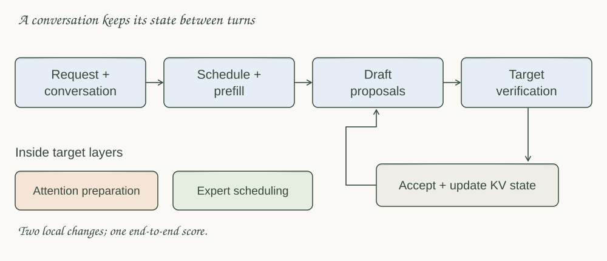
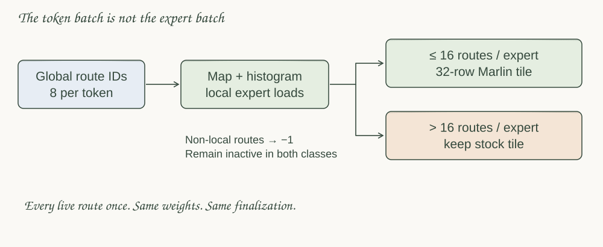
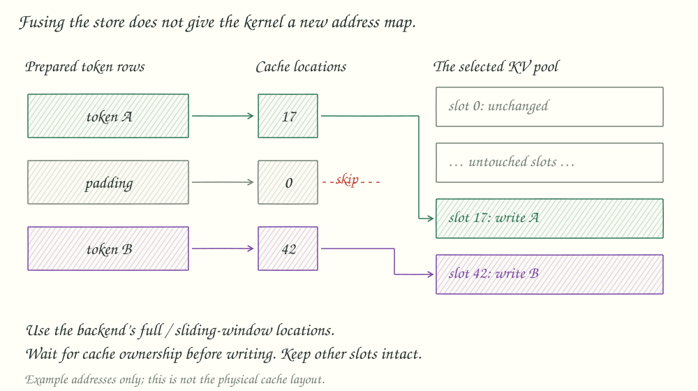

## The kernel got faster. Did the server? {#starting-point}

The most useful result from my Open Kernel Challenge project was not the highest score. It was a discrepancy: the final attention-preparation path was faster in local measurements, passed the official serving checks, and still did not improve my best recorded serving score.

My earlier expert-scheduling submission scored **1.0251×** against stock SGLang. The final submission, which added attention-preparation fusion, scored **1.0224×**. Both passed. The difference is small enough that these separate runs do not establish a statistically significant regression. They do establish something more modest: I did not demonstrate an incremental end-to-end win from the fusion.

I entered the serving track to learn how GPU optimization behaves inside a real inference system. This article follows that work from expert routing to a one-byte rounding discrepancy, and from local timing to the official eight-H200 evaluation. It is a record of what the experiments support, including the ideas I stopped pursuing.

<aside class="sidenote" data-follow="1"><strong>How this project was built</strong> I used coding and research agents for source investigation, implementation, probes and independent reviews. “I” refers to the project I ran; it does not mean I hand-wrote every kernel or personally completed every resource in the reading list.</aside>

The working question became: **what unnecessary work can I remove while preserving the computation that the rest of the server expects?** That question is less glamorous than replacing an entire attention kernel. It also turned out to be harder than it sounds.

## First, define the system being measured {#system}

The challenge's serving workload used Muse Spark Open with NVFP4 weights, SGLang v0.5.23 at commit `297e54fd`, and a whole node of **eight H200 GPUs**. The launch used tensor parallelism and expert parallelism across eight ranks, an FP8 KV cache, and DFlash speculative decoding with an eight-token block. The official scored run evaluated concurrency levels of 1, 4, 16 and 32 users. [1](#ref-contract)

Those details change the optimization problem. A model forward is only part of a conversation. Before a target-model verification step, the system must prepare draft tokens and metadata. During the step, attention reads the existing cache and experts process routed tokens. Afterward, verification determines what to accept, and state must remain correct for the next turn. The SGLang and DFlash papers provide background; the pinned source and Muse-specific DFlash2 card define the implementation used here. [2](#ref-system)

<figure><figcaption>The unit of optimization is a serving loop. This is a conceptual dependency diagram, not a measured execution timeline. <a href="assets/diagrams/serving-path.excalidraw" download>Editable diagram</a></figcaption></figure>

A standalone kernel benchmark answers a narrow question: how long does this operator take on these inputs? A serving benchmark also includes scheduling, draft execution, communication, memory pressure and the sequence of requests. A faster operator may occupy little of the exposed critical path, or its integration may introduce work elsewhere.

For a simple serial model, Amdahl's law gives the limit: if a fraction <var>f</var> of runtime is accelerated by a factor <var>s</var>, the total speedup is: [3](#ref-amdahl)

<div class="equation" aria-label="Speedup equals one divided by one minus f plus f divided by s">S = 1 / ((1 − f) + f / s)</div>

If a component occupies 5% of the total and becomes twice as fast, this model gives only about 1.026× overall. This is an illustration, not an estimate of my attention path. In a distributed server, overlap makes it especially important to identify exposed time rather than add operator durations together.

<div class="reading"><span>Study connection</span><a href="https://mlsyscourse.org/slides/14-LLM-serving-part1.pdf">CMU's LLM Serving slides</a> provide background for batching and cache management. They are useful alongside this system diagram; they are not evidence for the measurements below.</div>

### Two machines, two kinds of evidence

I could run local probes on an **L40**. The official evaluation ran on **H200s**. This split was useful for finding indexing, conversion and replay failures, but it was a poor substitute for profiling the target server. A local preparation benchmark did not execute FA3 attention on H200, its programmatic dependent launches, or the full multi-rank model.

I kept three categories separate: source reasoning, local experiments, and official serving results. A source audit could justify a test; a local test could reject an idea; an official pass could validate the submitted bundle on that workload. None of those automatically proved a universal speedup.

<aside class="sidenote"><strong>Two different questions</strong> The L40 could reveal a wrong byte or an indexing error. It could not tell me whether a change improved FA3, PDL and communication on eight H200s.</aside>

## Expert parallelism changes the size of the problem {#experts}

I started with the expert path. Muse's mixture-of-experts layer routes each token to eight of 256 experts. With eight-way expert parallelism, a rank owns 32 experts. The original route IDs are global; the rank has to map them into its local expert numbering and mark routes owned elsewhere as inactive.

The model dimensions in the pinned implementation were `hidden_size = moe_hidden_size = 4096`. On the expert path, the first matrix multiplication produces the gate and up projections together: **N = 8192, K = 4096**. The second projects back with **N = 4096, K = 4096**. Getting these dimensions right mattered; one research report initially used incorrect full dimensions and later issued an erratum. [4](#ref-marlin) [5](#ref-evidence)

To see why the route count matters, write the first expert projection as a matrix multiplication. Each routed activation supplies one row of Aₑ. One output entry is the dot product of that row with a column of the expert’s logical weight matrix. Quantized packing changes how the weights are stored, but it does not change these logical dimensions.

<figure><figcaption>The geometry of one expert’s first projection. The highlighted row and column produce one output entry. The small grids stand in for much larger tensors. <a href="assets/diagrams/expert-geometry.excalidraw" download>Editable diagram</a></figcaption></figure>

The important scheduling quantity was not just the number of tokens in the forward. It was the number of routes assigned to **each local expert**. Two forwards with the same token count can produce very different expert loads.

Imagine two experts receiving 12 and 50 routes. A row tile sized for the busier expert can waste work on the quieter one. Making every tile smaller is not free either: it can change launch count, weight reuse, occupancy and the kernel's numerical reduction strategy.

Here, the matrix's row dimension is the number of routed token activations for an expert; the weight dimensions stay fixed. A 12-route expert does not become a larger useful computation merely because the whole forward has hundreds of tokens. That is the reason to classify by expert occupancy rather than apply one smaller tile to the entire forward.

<aside class="sidenote" data-paragraphs="3"><strong>Two different numbers</strong> The threshold selects the class. The tile size says how many rows that class processes at a time. In the accepted variant those numbers are 16 and 32, respectively.<span class="mini-caption">A row-slot illustration, not a timing estimate.</span></aside>

<figure><figcaption>Classify whole experts by their route count. The occupancy threshold of 16 is distinct from the 32-row tile used for the small class. <a href="assets/diagrams/expert-routing.excalidraw" download>Editable diagram</a></figcaption></figure>

Public kernel-track reports supplied an initial lead: keep Marlin's NVFP4 computation and change the scheduling around it. The project's source register credits the public work by georgxzh, alygg77 and hariappi; those results were motivation, not measurements of my distributed serving patch. [6](#ref-prior)

### The version that survived

The successful adaptive variant used a **32-row tile for experts with at most 16 routes**, retaining the stock larger tile for the other experts. The dispatch was derived from tensor dimensions, the stock tile and expert metadata. Under this model's configuration, the adaptive regime covered token counts from 116 through 512. It was not a branch on the benchmark's user labels.

<aside class="sidenote"><strong>Dispatch by the problem</strong> Tensor shapes and expert occupancy are properties of the computation. “Four users” or “sixteen users” are labels from the evaluator. The optimization must work from the former.</aside>

In simplified pseudocode, the partition looks like this:

```python
# Explanation only: real classification runs on the GPU.
local_ids = map_global_to_local(global_ids)  # -1 means non-local
live = local_ids >= 0
bins = where(live, local_ids, num_local_experts)
loads = histogram(bins, num_bins=num_local_experts + 1)
small = live & (loads[bins] <= 16)

small_ids = where(small, local_ids, -1)
large_ids = where((local_ids >= 0) & ~small, local_ids, -1)

# Each live route belongs to exactly one class.
run_marlin_for_class(small_ids, row_tile=32)
run_marlin_for_class(large_ids, row_tile=stock_tile)
```

The extra histogram bin keeps inactive routes from indexing with `-1`. They remain masked out regardless of that bin's count. The two execution classes must be disjoint, cover all live routes, and retain the original route weights and finalization semantics.

For the six-route excerpt in the figure, a rank maps `[32, 33, 7, 32, 65, 33]` to `[0, 1, -1, 0, -1, 1]`. Suppose the full forward assigns 12 routes to local expert 0 and 50 to local expert 1. The small output keeps `[0, -1, -1, 0, -1, -1]`; the large output keeps `[-1, 1, -1, -1, -1, 1]`. Nothing is dropped or counted twice among the live routes.

<aside class="sidenote"><strong>Count the whole forward</strong> The six IDs are only an excerpt. The 12 and 50 come from the full histogram, not from counting the six drawn cells. Route weights stay attached to their original positions.</aside>

The implementation runs the two classes through the first projection, applies the existing activation, then runs the classes through the second projection. It retains Marlin's packed weights, scales and arithmetic operations. Sharing scratch space is valid only if one class cannot corrupt the other's live outputs and every replay reestablishes the state it needs.

### A smaller tile was not automatically a better tile

An earlier 16-row approach failed a local numerical comparison. Diagnostic runs traced the discrepancy through the first projection, activation and second projection. Changing a tile can change FP32 accumulation grouping before BF16 rounding, even when the nominal data types and model equations stay the same. The original failure was retained; an official check passing did not erase it.

This was my first warning that “same kernel, different launch” was too weak a correctness argument. The accepted 32-row variant was a separate candidate with its own tests and submitted identity, not a relabeling of the failed one.

<div class="reading"><span>Study connection</span><a href="https://siboehm.com/articles/22/CUDA-MMM">Si Böhm's CUDA matmul worklog</a> is a good companion for understanding why tiling changes reuse and execution. <a href="https://mlsyscourse.org/slides/06-CUDA-programming.pdf">CMU's GPU Architecture &amp; CUDA Programming slides</a> cover the thread hierarchy and reductions. Neither establishes numerical equivalence for this Marlin path.</div>

## Fuse the integer work around the experts {#classifier}

The next step was smaller in scope: combine route mapping and occupancy classification into one Triton kernel. The earlier implementation expressed parts of this with separate tensor operations. Those operations still cost launches and temporary tensors even though they do not perform the expensive matrix multiplications.

There was useful prior art beyond this challenge. The project's Nice Solutions audit credits the GEMM People report for the principle of fusing small routing and dispatch operations. That work used a different model and a B200. I borrowed the question to ask, not its measured speedup or its kernel implementation. [7](#ref-precedents)

The fused classifier loads global IDs, maps them to local IDs, constructs a histogram, looks up each route's expert load, and writes the small and large route arrays. This is integer bookkeeping. It does not change activation precision, route weights or the expert GEMM equations.

The distinction between **fusing bookkeeping** and **changing floating-point reductions** became valuable. I could test classification exactly: every live route appears once, every non-local route remains inactive, and the two execution classes agree with the reference partition under changing graph inputs.

The adaptive parent scored **1.0247×**. Adding the fused classifier produced **1.0251×**, the highest completed score in my project. That 0.0004 difference was nominal; separate runs did not establish that the classifier caused an improvement of that size. The stronger result was that the combined patch passed the official all-load evaluation. [8](#ref-fused)

<aside class="sidenote"><strong>Names matter</strong> “Fused-stock” in the results means the fused adaptive expert patch with stock launch flags. It is not unmodified stock SGLang.</aside>

## A second opportunity: work before attention {#attention}

After expert scheduling, I looked at the operations around FA3 attention. The serving path already had sophisticated kernels. There was still a smaller opportunity: intermediate conversions and cache writes around them.

The names are worth unpacking. A query **Q** is compared with keys **K** to determine how to combine values **V**. The KV cache retains keys and values from earlier tokens, so later generation can reuse them. RoPE rotates Q and K to encode position. FA3 is the FlashAttention-3 backend consuming those prepared tensors. The optimization here changes how its inputs are prepared, while retaining the attention computation itself. The underlying methods deserve their own credit: RMSNorm, RoPE and FlashAttention-3 are existing work. [9](#ref-attention-papers)

On the eligible path, stock normalized Q and K, applied RoPE where needed, converted K and V for the FP8 cache, stored the cache entries, and converted Q to FP8 for FA3. Instead of replacing attention, I explored folding some of that preparation into the existing QK kernel. SGLang already contained related fusion machinery; the work here was adapting its eligible FA3 path and preserving the backend's contracts. [10](#ref-attention-code)

<figure><figcaption>Three preparation paths; the same downstream attention implementation. Box widths are schematic, not timings. <a href="assets/diagrams/attention-fusion.excalidraw" download>Editable diagram</a></figcaption></figure>

**Variant A** fused the FP8 KV conversion and store while retaining a BF16 query output. The ordinary query cast remained before FA3. **Variant B** also emitted the FP8 query, making the downstream same-dtype cast a no-op. Both were built on the earlier fused expert patch, using stock launch flags.

This resembles the motivation in Triton's [fused-softmax tutorial](https://triton-lang.org/main/getting-started/tutorials/02-fused-softmax.html): intermediate operations can create avoidable memory traffic and launches. But the softmax example is a learning model, not proof that the same transformation is safe inside a stateful attention backend.

### Moving the store means taking responsibility for it

The fused path had to write to the same full-attention or sliding-window cache locations as stock. Slot zero remained reserved for graph padding. Untouched slots had to remain untouched. A backend wait that protects cache ownership still had to happen before the new writer ran.

<figure><figcaption>A cache write is an address-and-state contract. These example locations illustrate the invariant; the backend supplies the real full-attention or sliding-window locations. <a href="assets/diagrams/cache-writes.excalidraw" download>Editable diagram</a></figcaption></figure>

The dispatch was deliberately narrow: eligible FA3 decode or target-verify calls, the expected unscaled FP8 cache layout, and compatible buffers. Prefill, mixed batches, incompatible cache settings and other backends retained the ordinary path. “Can this kernel compute the values?” was only half the question. The other half was “who writes the cache when this branch is not taken?”

<aside class="sidenote"><strong>Exactly one writer</strong> An eligible fused call owns the cache write. An ineligible call must restore the ordinary backend write. Getting the arithmetic right is insufficient if the fallback writes twice—or never writes.</aside>

There was a synchronization question too. [Programmatic Dependent Launch](https://docs.nvidia.com/cuda/cuda-programming-guide/04-special-topics/programmatic-dependent-launch.html), or PDL, permits a dependent kernel to start before its producer fully finishes. The consumer must still wait before reading dependent data. Removing the separate query cast therefore required auditing the actual launch chain into FA3, rather than assuming that an unchanged Python call order guaranteed the needed device ordering. That audit followed the pinned launcher, preparation and consumer code, not just the attention paper. [10](#ref-attention-code)

### Preserve the rounding boundary

Stock materializes BF16 values before the FP8 conversion. Fusing those operations must not accidentally convert an earlier FP32 intermediate directly to FP8. In general, these are different operations:

<div class="equation">FP8(BF16(x)) ≠ FP8(x)</div>

The implementation retained that intermediate rounding and checked the installed PyTorch version's saturation and NaN behavior. An early research note made an incorrect overflow claim; checking the pinned implementation corrected it. This is exactly the kind of detail that should come from the actual dependency rather than memory of a different version. [11](#ref-conversion)

<aside class="sidenote" data-follow="1"><strong>Fusion is not permission to skip rounding</strong> A temporary tensor may disappear; its numerical effect may still be required.</aside>

The earlier survey had already recorded a related warning from the NKI team 7013 report: moving a BF16 materialization boundary can change the integrated result. That was a useful constraint, though it did not anticipate or explain the tile-dependent failure that came next. [7](#ref-precedents)

The local tests included production-path byte comparisons and probes using all 65,536 BF16 input encodings. That is extensive input-pattern coverage, not an exhaustive proof over every tensor, position, graph and compiler combination.

<div class="reading"><span>Study connection</span><a href="https://humansand.ai/blog/gpu-accelerated-weight-teleportation">GPU-accelerated Weight Teleportation</a> is a useful parallel reading on avoiding intermediate handoffs. It concerns RL weight synchronization, not this serving patch. I did not implement its compression or weight-sync pipeline.</div>

## The failure hiding at a tile boundary {#rounding}

The most instructive bug appeared after the initial local tests and source reviews looked encouraging. A reviewer noticed that adding V rows changed the row count used to select a Triton launch configuration.

For this rank, Q has 16 heads and K has two. Stock QK preparation therefore uses **18 × T rows**, where <var>T</var> is the token count. Including the two V heads changes the fused workload to **20 × T rows**. The extra rows are real work, but they do not belong to the QK normalization whose numerical behavior I wanted to preserve.

At T = 56, stock sees 1,008 rows while fusion sees 1,120. They fall on opposite sides of a 1,024-row configuration boundary. At T = 410, the counts are 7,380 and 8,200, straddling another boundary at 8,192 rows.

<aside class="sidenote"><strong>Which threshold?</strong> At T = 410, stock and fusion choose different tile families. That does not mean stock changes its own family between T = 409 and T = 410. An earlier assessment made that mistake; the retained correction matters.</aside>

<figure><figcaption>A scheduling detail became a numerical difference. Changing the tile changed the compiler's reduction grouping in the controlled local probes. <a href="assets/diagrams/rounding-boundary.excalidraw" download>Editable diagram</a></figcaption></figure>

<div class="explorer" id="tile-explorer">
<div class="explorer-title">Explore the dispatch boundary <span>Source-derived model · not a GPU benchmark</span></div>
<label for="tokens">Token count T</label><input id="tokens" type="range" min="1" max="512" value="56"><output id="token-output" for="tokens">56</output>
<div class="preset-buttons"><button type="button" data-token="51">51</button><button type="button" data-token="56">56</button><button type="button" data-token="57">57</button><button type="button" data-token="410">410</button><button type="button" data-token="455">455</button><button type="button" data-token="456">456</button></div>
<div class="tile-values"><div>Stock Q + K<strong id="stock-rows">1,008 rows</strong><span id="stock-tile">BLOCK_M = 4</span></div><div>Original fusion Q + K + V<strong id="fused-rows">1,120 rows</strong><span id="fused-tile">BLOCK_M = 8</span></div></div>
<p id="tile-note" aria-live="polite">Different tile families. This identifies a configuration boundary, not a prediction that every input will fail.</p>
</div>

Targeted tests found query-byte failures in both original candidates. Variant A failed seven eager cases and eleven graph cases; Variant B failed two eager cases, at T = 410 and T = 416. The failures were finite values, independently reproducible—not just a disagreement over NaN representation. T = 56 also corresponds to seven eight-token verification requests, so boundary testing was not merely academic.

The controlled experiment held the saved input fixtures fixed and varied the tile and contraction settings. Forcing stock to use the fused tile reproduced differences. Matching the stock tile fixed the original minimized failures. Disabling arithmetic contraction did not fix the across-tile discrepancy.

The compiler artifacts gave the mechanism substance. With one tile family, each thread accumulated four local square contributions before shuffles; another accumulated eight. FP32 addition is not associative. A small difference in the RMS statistic can push a normalized value over a BF16 midpoint. A subsequent FP8 rounding boundary can make that change visible in the final query byte.

For one head's vector, the normalization scales each component by <code>1 / sqrt(mean(x²) + epsilon)</code>. Changing the grouping of the sum of squares can change that scale by a tiny amount. Most outputs still round to the same stored value. The revealing inputs are those already close to a rounding midpoint: a tiny movement can send them to the other representable value. This is why broad random tests passed before the retained boundary fixtures exposed a failure.

<figure><figcaption>Why one byte can expose a real numerical change. This number line explains the mechanism; it is deliberately not drawn as a quantitative plot of the saved fixtures. <a href="assets/diagrams/rounding-midpoint.excalidraw" download>Editable diagram</a></figcaption></figure>

I had not changed the mathematical normalization formula. I had changed the grouping of the finite-precision operations that implement it. NVIDIA's floating-point guide explains the general reduction-order issue; the controlled probes establish what happened in these particular failures. [12](#ref-numerics) [13](#ref-repair)

### The first repair was still incomplete

The first change selected the tile using stock's Q+K row count while keeping the grid large enough for Q+K+V:

```python
# Simplified from the repaired FA3 preparation path.
config_rows = tokens * (num_q_heads + num_kv_heads)
block_m, num_warps = triton_config(config_rows)

work_rows = tokens * (num_q_heads + 2 * num_kv_heads)
grid = ceil_div(work_rows, block_m)
```

That fixed the original fixtures. A wider boundary sweep then found query/key discrepancies in the stock `BLOCK_M = 32` family, including T = 3641. Matching the tile was not a universal repair. The final candidate therefore left that entire compilation family on the ordinary stock path, using actual shape and head metadata to make the decision.

This was not a whitelist of benchmark sizes. The optimized path declared a family it did not support, and model dispatch restored the existing query conversion and cache writer there. The underlying wider-family arithmetic discrepancy remained unexplained; fallback avoided executing it.

<aside class="sidenote"><strong>Fallback is part of the implementation</strong> The final repair did not solve every reduction discrepancy. It supported the tested tile families and sent the unsupported family through stock, including stock’s cache writer.</aside>

## A test must exercise the failure it claims to exclude {#validation}

The repaired candidate passed a dense eager sweep over every T from 1 through 512, both RoPE modes, and two finite seed families: **2,048 comparisons**. Query bytes, BF16 key bytes, full cache bytes, dtypes and production stride were checked against an independently imported pinned-stock reference. Preserved failing fixtures failed before the repair and passed afterward.

Separate tests covered exceptional values, tile boundaries, changing graph inputs and cache locations, padded rows, untouched slots, and actual model dispatch back to stock. The local attention consumer was still a stub. Compiling six SM90 configurations was useful, but it did not execute H200 FA3 or PDL.

<aside class="sidenote"><strong>2,048 means cases, not a proof</strong> 512 token counts × two RoPE modes × two finite seed families. It covers every count in that interval for those inputs, not every possible tensor value.</aside>

<figure><figcaption>Each stage answers a different question. Later evidence adds coverage; it does not turn the earlier tests into universal proofs. <a href="assets/diagrams/evidence-ladder.excalidraw" download>Editable diagram</a></figcaption></figure>

The local preparation measurements were encouraging: **4.56–5.21 μs per layer saved** at the tested smaller sizes on the L40. These measurements included the device-side QK/RoPE preparation, casts and cache store. They excluded CPU dispatch, projections, FA3 itself, communication and the rest of serving. I could not responsibly turn that number into an H200 score forecast.

The final official submission was the exact repaired bundle, with stock flags and no mixed-chunk override. It completed successfully: all **176 reference turns** passed, later-turn checks passed across **45,154 served positions**, and reported memory was **0.2 GB per GPU below stock**. This closed the previously untested integrated-H200 question for the evaluated workload. It did not prove that every optimized branch ran, or how much time each branch saved. [14](#ref-result)

## What the serving results actually say {#results}

The official score compares throughput at stock's per-user interactivity point at each load and aggregates the ratios geometrically. It is not simply the maximum raw tokens per second observed in a kernel benchmark. The table below preserves the reported frontier ratios rather than substituting raw throughput measurements. [1](#ref-contract)

<figure class="results-figure"><figcaption>Percentage improvement over each run's stock reference. No error bars are available for this candidate comparison; none are invented. <a href="evidence/results.csv" download>Download the data</a></figcaption></figure>

| Concurrent users | Fused expert scheduling | + Repaired attention preparation |
| :--- | ---: | ---: |
| 1 | 1.0387× | 1.0318× |
| 4 | 1.0091× | 1.0097× |
| 16 | 1.0217× | 1.0217× |
| 32 | 1.0311× | 1.0265× |
| **Reported aggregate** | **1.0251×** | **1.0224×** |

The final patch improved slightly at four users, matched at sixteen to the reported precision, and scored lower at one and thirty-two. The aggregate difference is **0.0027**, or about **0.263% relative to the earlier score**. These were separate official runs with their own stock references, not randomized repeated comparisons between the two candidates.

<aside class="sidenote"><strong>Read the denominator</strong> Each ratio compares a candidate with its stock reference. Comparing the two ratios does not turn the runs into a paired, repeated candidate-versus-candidate experiment.</aside>

The raw 32-user measurement reported one repetition. Its zero reported spread is not evidence of zero variability. Some latency measurements worsened as well, but neither the score difference nor those latency differences establishes a causal regression from fusion.

Why did local savings not become a higher score? The available evidence does not settle that. Hardware differences, integration overhead, branch frequency, the fraction of runtime affected and run variability are candidate explanations—not findings. The returned logs were truncated and contained no per-kernel activation counts or profiler trace. A useful next experiment would measure the actual branch coverage and exposed preparation time on the same H200 system before attributing the result to any one mechanism.

My earlier **1.0251×** entry remained the highest recorded completed submission. The final experiment added correctness and integration evidence, but no demonstrated incremental aggregate gain. I do not infer a competition placement from these scores.

## The branches I did not promote {#dead-ends}

A tidy optimization story can make the search look inevitable. This one was not. Several ideas remained attractive until the evidence narrowed their value.

| Direction | Why it was considered | What stopped promotion |
| :--- | :--- | :--- |
| Expand NVFP4 weights, then use BF16 GEMM for large prefill | A different compute regime might suit large chunks | Numerical failures and poor complete-path local performance; no demonstrated serving benefit |
| Prefix-specialized Marlin scheduling | Avoid generic expert-parallel overhead | An unexplained watchdog stall; a later combined pass did not establish a repair |
| Cache tokenization of conversation segments | Repeated long-prefix encoding looked avoidable | Serialization overhead, tokenizer-mutation behavior and uncertain benchmark applicability |
| Shorter DFlash block | Reduce work per verification step | The 16-user check passed but returned an indicative 0.981 ratio |
| Mixed chunking | Change how prefill and decode share execution | Parent-plus-mixed scored 1.0241; fused-plus-mixed checks passed, but that exact combination did not receive an all-load score |
| Mask padding or remove COUNT specialization | Avoid work or first-use compilation | Limited modeled headroom or unknown runtime frequency; no final change |
| Replace the attention implementation | Potentially reduce attention's larger streaming cost | Substantial numerical, workspace, synchronization and target-hardware validation work remained |

These outcomes have different meanings. A numerical failure is a blocker for that candidate. A weak measurement is not proof that the whole idea is impossible. An untested combination is not a result. Preserving those distinctions kept an appealing hypothesis from silently becoming a claim of success.

Public reports helped frame those decisions. alygg77's negative-results document and thethings.ai's projection worklog supplied counterexamples to assuming that less traffic, extra overlap or a better local proxy must improve the measured workload. The larger attention branch examined vjeux's public implementation and its derivatives; it was left unported. Those sources deserve credit even where the result was a decision not to adopt their technique. [15](#ref-alternatives)

<aside class="sidenote"><strong>Negative results are useful results</strong> “This candidate failed” and “this entire idea can never work” are very different conclusions. The table records the former without claiming the latter.</aside>

## What I would carry into the next project {#lessons}

I would get target-hardware feedback earlier. The L40 was valuable for rejecting incorrect code, but I spent the last part of the project qualifying a path whose H200 integration and benefit were still unknown. Earlier paired serving measurements would have made the final choice less speculative.

I would also design boundary tests alongside the first optimization, not after the first review. A dispatch heuristic is part of the executable program. Its thresholds deserve adjacent test cases, retained failure fixtures and changing-input replay just as much as the arithmetic body does.

Finally, I would separate the narrative of learning from the claim of improvement. I learned more from the extra V rows changing a QK reduction than from a small movement in the scoreboard. But understanding a failure does not earn a performance gain. The serving measurement still has the last word.

The practical result is modest: a best recorded **2.51% improvement on the challenge's aggregate metric**, and a second, more involved patch that passed but did not beat it. The reusable result is a method: map the actual execution path, preserve the numerical boundaries, test the dispatch edges, and measure the whole system before promoting the story you want the kernel to tell.

## Reading beside the experiments {#reading}

For a reader following the same questions, this sequence connects GPU fundamentals to the issues in the experiments. These links are further reading. The measured claims above come from the pinned source, local artifacts and official results. The [annotated source ledger](sources.html) also records the papers, exact repository revisions, reviewed reports and limits of the original reading coverage.

| Question to take into the material | Resource | How it connects |
| :--- | :--- | :--- |
| What does a tile change besides arithmetic count? | [Si Böhm: CUDA matmul worklog](https://siboehm.com/articles/22/CUDA-MMM) | Build an intuition for reuse, thread mapping and measured iteration. |
| How do memory movement and compute fit together? | [Aleksa Gordić: matmul](https://www.aleksagordic.com/blog/matmul) | Further reading and a visual teaching reference for this revised article; not a source of the submitted patch. |
| Where do threads, warps and reductions fit? | [CMU 15-442/642: GPU Architecture & CUDA Programming](https://mlsyscourse.org/slides/06-CUDA-programming.pdf) | Background for the launch and reduction discussion. |
| How do layouts map logical work onto threads? | [CMU: Data Layouts](https://mlsyscourse.org/slides/data_layout/) | A companion to reading compiler layouts, not a diagnosis of this bug. |
| Why can fusion save traffic and launches? | [Triton: Fused Softmax](https://triton-lang.org/main/getting-started/tutorials/02-fused-softmax.html) | A small runnable example before reasoning about stateful KV stores. |
| What sits outside the model operator? | [CMU: LLM Serving, Part 1](https://mlsyscourse.org/slides/14-LLM-serving-part1.pdf) | Batching and cache concepts behind the serving loop. |
| How can scheduling specialize work on a GPU? | [CMU 15-779: Warp Specialization](https://www.cs.cmu.edu/~zhihaoj2/15-779/slides/06-warp-specialization.pdf) | Further study; warp specialization was not implemented in this patch. |
| When can a dependent kernel read its inputs? | [NVIDIA: Programmatic Dependent Launch](https://docs.nvidia.com/cuda/cuda-programming-guide/04-special-topics/programmatic-dependent-launch.html) | Background for auditing the producer/FA3 consumer boundary. |
| What does removing an intermediate handoff buy? | [humans&: GPU-accelerated Weight Teleportation](https://humansand.ai/blog/gpu-accelerated-weight-teleportation) | A separate RL systems case study; no weight-sync mechanism was ported here. |

### Following a post to its evidence

X was useful for discovery, not as a benchmark authority. The research supplement followed announcements by @pranjalssh and @lmsysorg to the LMSYS Muse megakernel article, and @NathenFernandes to a public projection implementation. Rohan Arun's post led to a research-harness PR. Direct X access was restricted, so the record distinguishes indexed leads from the primary articles and code that could actually be inspected. The megakernel example targeted GB300, and none of these social claims establishes an H200 serving gain for my patch. [16](#ref-social)

## Sources, attribution & reproduction {#sources}

The references below support the nearby claims. The [full source ledger](sources.html) separates implementation evidence, prior art, social discovery and suggested study; it includes the relevant screened repositories without presenting them as adopted work. [Download the ledger](sources.md).

<ol class="references">
<li id="ref-contract"><strong>Competition contract.</strong> <a href="https://openkernelchallenge.dev/llms.txt">Official serving documentation</a>. The project pinned SGLang <code>297e54fd105e974cdf401e5b4d20253a22c16f90</code>. Results here describe saved November 2026 evaluations, not a live leaderboard.</li>
<li id="ref-system"><strong>Serving and drafting foundations.</strong> Zheng et al., <a href="https://arxiv.org/abs/2312.07104v2">SGLang</a> (2024); Chen, Liang and Liu, <a href="https://arxiv.org/abs/2602.06036v2">DFlash</a> (2026). For this deployment, see the <a href="https://huggingface.co/RadixArk/Muse-Spark-Open-DFlash2">Muse DFlash2 model card</a> and <a href="sources.html#implementation">pinned implementation map</a>. The papers are background, not evidence of this patch's score.</li>
<li id="ref-amdahl"><strong>Component versus system speedup.</strong> Amdahl (1967), <a href="https://doi.org/10.1145/1465482.1465560">Validity of the single processor approach to achieving large scale computing capabilities</a>. The equation above uses a simplified fixed-work model.</li>
<li id="ref-marlin"><strong>Existing expert implementation.</strong> Frantar et al., <a href="https://arxiv.org/abs/2408.11743v1">MARLIN</a> (2024), and SGLang's later <a href="https://github.com/sgl-project/sglang/blob/297e54fd105e974cdf401e5b4d20253a22c16f90/python/sglang/srt/layers/muse_spark/muse_spark_fp4_moe.py">NVFP4 expert module</a> and <a href="https://github.com/sgl-project/sglang/blob/297e54fd105e974cdf401e5b4d20253a22c16f90/python/sglang/srt/models/muse_spark.py">Muse model</a> at the competition pin. The paper's original kernel is distinct from this MoE adaptation.</li>
<li id="ref-evidence"><strong>Project record.</strong> <a href="evidence/CLAIM_MAP.md">Claim-to-artifact map</a>, with paths and SHA256 hashes for the project reports and patches used in this article. <a href="evidence/source-inventory.json">Source inventory</a> records the audited evidence; it is not an assertion that every vendored SGLang file was read.</li>
<li id="ref-prior"><strong>Scheduling prior art.</strong> <a href="https://github.com/georgxzh/muse-kernel-challenge/blob/890fa976c031b2433a5826d02c9355c25fa21efe/README.md">georgxzh's technical write-up</a> (<code>890fa976</code>), <a href="https://github.com/alygg77/okc-muse-spark-kernels/blob/6cae49a639ee6d14b929a5fd4a63c627f96d7dc0/docs/H200_MEASURED_FACTS.md">alygg77's H200 measured facts</a> (<code>6cae49a6</code>) and <a href="https://github.com/hariappi/okc-muse-spark-kernels/blob/a3ebb0f2f027f07f38b063c6a74ac355a6b38848/README.md">hariappi's kernel/serving report</a> (<code>a3ebb0f2</code>). Their component evidence motivated this investigation; it is not a measurement of my serving patch.</li>
<li id="ref-precedents"><strong>Cross-project lessons.</strong> <a href="https://github.com/Jerry2423/MoE-Kernel-Agent/tree/86c1e3f96d6478c3feed5b4f04f76810446618b8">GEMM People / MoE Kernel Agent</a> and <a href="https://github.com/charleshong3/nki-moe-7013/tree/751a7bf592a319600f6de679f354462eec74d704">NKI team 7013</a>. The project audit records report-level reading and transferred principles, not a full code study or a port. Exact scopes appear in the <a href="sources.html#prior-art">ledger</a>.</li>
<li id="ref-fused"><strong>Best completed run.</strong> <code>68283766046b49f0</code>, aggregate 1.0251. Patch <code>a2d84a8290b0…</code>. <a href="evidence/fused-result.md">Archived result review</a>.</li>
<li id="ref-attention-papers"><strong>Attention's underlying methods.</strong> Zhang and Sennrich, <a href="https://arxiv.org/abs/1910.07467v1">RMSNorm</a> (2019); Su et al., <a href="https://arxiv.org/abs/2104.09864v5">RoFormer / RoPE</a> (2023 revision); Shah et al., <a href="https://arxiv.org/abs/2407.08608v2">FlashAttention-3</a> (2024). Full bibliographic details are in the <a href="sources.html#papers">paper list</a>.</li>
<li id="ref-attention-code"><strong>Actual fusion and launch paths.</strong> SGLang's <a href="https://github.com/sgl-project/sglang/blob/297e54fd105e974cdf401e5b4d20253a22c16f90/python/sglang/kernels/ops/attention/muse_spark_qk_norm_rope_store.py">QK/RoPE/store implementation</a> and <a href="https://github.com/sgl-project/sglang/blob/297e54fd105e974cdf401e5b4d20253a22c16f90/python/sglang/srt/layers/attention/flashattention_backend.py">FA3 backend</a>. The <a href="sources.html#implementation">five-file FA3 source trail</a> uses <code>sgl-attn f89bc230</code>; the <a href="evidence/fa3-feasibility-review.md">archived feasibility review</a> explains the source-level ordering argument. Its earlier validation status and COUNT estimate are historical; the ledger records the later interpretation.</li>
<li id="ref-conversion"><strong>Version-specific FP8 conversion.</strong> <a href="evidence/variant-a-review.md">Independent A review</a>, section “Corrections,” records the PyTorch 2.14.1 header, hash and conversion function. Its conversion correction remains relevant; the later boundary failures superseded its initial candidate-level “no blocker” verdict.</li>
<li id="ref-numerics"><strong>Floating-point background.</strong> NVIDIA, <a href="https://docs.nvidia.com/cuda/floating-point/index.html">Floating Point and IEEE 754 Compliance</a>, sections 2.2 and 3, on order-dependent results and dot-product implementations. The project-specific diagnosis is supported separately by the repair evidence.</li>
<li id="ref-repair"><strong>Numerical repair.</strong> <a href="evidence/repair-review.md">Final source and local review</a>, <a href="evidence/dense-sweep-review.md">independent dense-sweep addendum</a>, and <a href="evidence/repair-delta.patch">the repair delta from blocked B</a>. Historical statements about pending H200 validation describe the time those reviews were written; the final run subsequently passed.</li>
<li id="ref-result"><strong>Final completed run.</strong> <code>cfa908f197674235</code>, aggregate 1.0224. Patch <code>04ec69722720…</code>. <a href="evidence/repaired-result.md">Archived result review</a> and <a href="evidence/results.csv">chart data</a>. No raw prompts, model weights or credentials are included in this notebook.</li>
<li id="ref-alternatives"><strong>Counterexamples and unadopted work.</strong> <a href="https://github.com/alygg77/okc-muse-spark-kernels/blob/6cae49a639ee6d14b929a5fd4a63c627f96d7dc0/docs/NEGATIVE_RESULTS.md">alygg77's negative-results report</a>, <a href="https://thethings.ai/p/okc/muse-bf16-proj-report">thethings.ai's projection worklog</a>, and <a href="https://github.com/vjeux/okc-2026/tree/f35a41ee1c13e316dabbf772830d47b23b453393">vjeux's public attention implementation</a>. Their experiments are credited to their authors and are not included in my score table.</li>
<li id="ref-social"><strong>X discovery, followed to primary sources.</strong> Pranjal Shankhdhar / LMSYS, <a href="https://www.lmsys.org/blog/2026-11-05-muse-spark-open-ultrafast">Muse Spark Open Ultrafast</a>; Nathen Fernandes, <a href="https://github.com/NathenFernandes/muse-bf16-proj/blob/86aff75e6aca72511bf9b41b6dc190bf1e763373/README.md">projection write-up</a>; Rohan Arun, <a href="https://x.com/RohanArun/status/2114830856393027974">X post</a> and <a href="https://github.com/rohanarun/Auto-research-agent/pull/6">linked PR</a>. The <a href="sources.html#social-trail">discovery ledger</a> records the mirror/direct-access limits and screened leads.</li>
</ol>

<p class="colophon">Written from the project record · Citations audited 22 November 2026<br>Original diagrams and prose. Layout and visual teaching references: <a href="https://humansand.ai/blog/gpu-accelerated-weight-teleportation">humans&amp;</a> and <a href="https://siboehm.com/articles/22/CUDA-MMM">Si Böhm</a>, plus <a href="https://www.aleksagordic.com/blog/matmul">Aleksa Gordić</a>. Figures were drawn for this project, not copied from those articles. Built as an independent companion to my website.</p>
