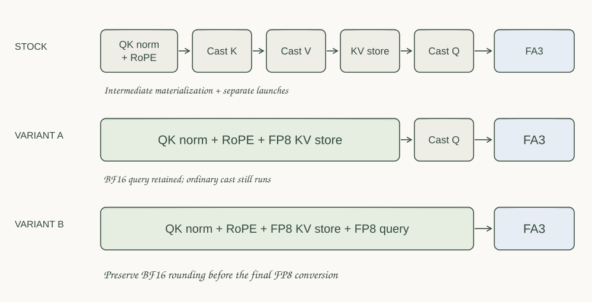
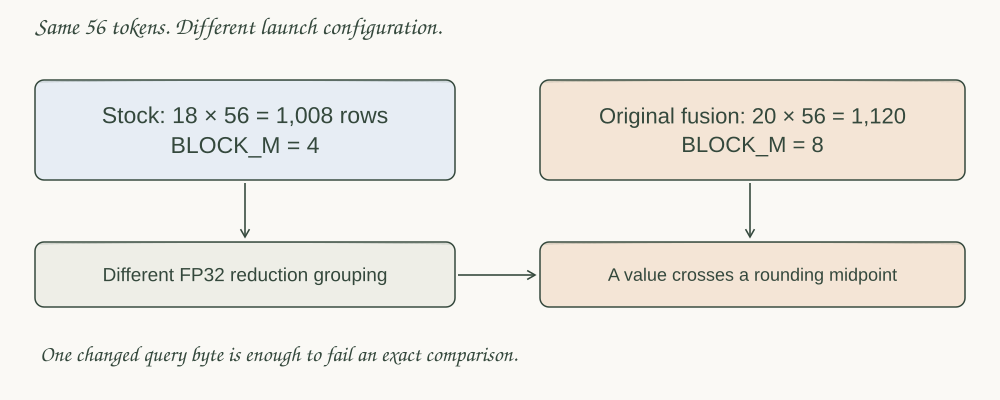
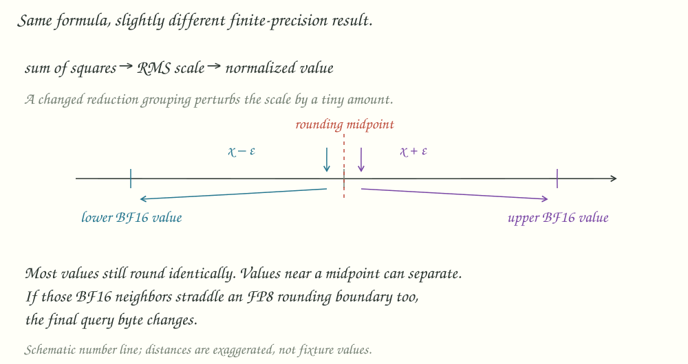
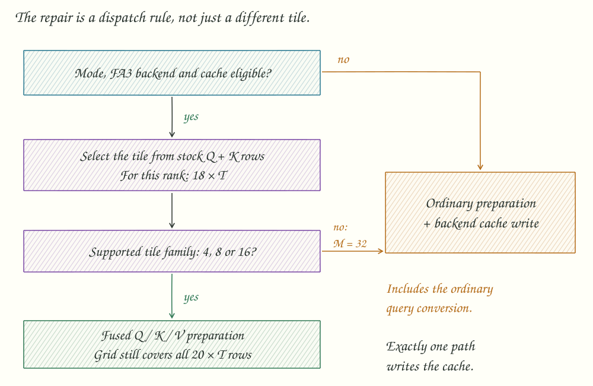
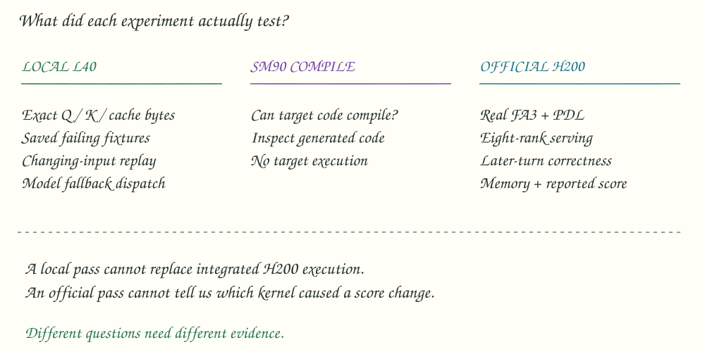
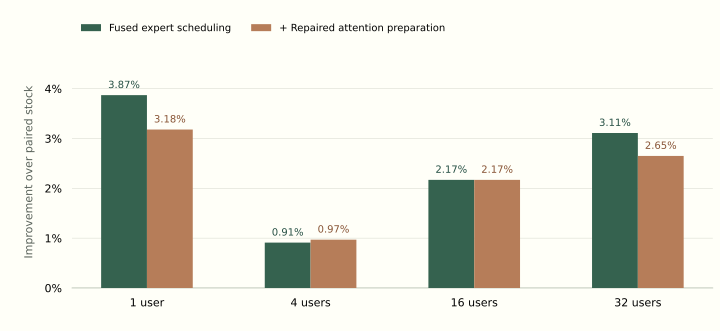

## The kernel got faster. Did the server? {#starting-point}

Near the end of the Open Kernel Challenge, I had an attention-preparation kernel that ran faster on my local GPU. The submitted version passed the official serving evaluation too. But its score was lower than the simpler expert-scheduling patch I had submitted earlier.

The earlier patch scored **1.0251×** against unmodified SGLang; the final one scored **1.0224×**. That is too small a difference between separate runs to conclude that fusion made the server slower. It was enough, though, to leave me with a question: where had the local savings gone?

I entered the serving track to learn how GPU optimization behaves inside a real inference system. I started with expert routing, changed how lightly loaded experts were scheduled, and then tried to fuse the small operations before attention. Along the way, adding two rows of work per token exposed a rounding bug in a normalization I thought I had left alone.

<aside class="sidenote" data-follow="1"><strong>About the work</strong> I ran this project with coding and research agents. They helped investigate the source, implement changes, run probes and review the results. This is an account of that collaboration.</aside>

Most of the changes began with the same idea: do less work around the existing kernels. That meant fewer route-processing launches, less wasted work on small experts, and fewer intermediate attention tensors. The tricky part was keeping the rounded values and cache writes the same.

## The server I started with {#system}

The reference system—called **stock** throughout this article—served Muse Spark Open with SGLang v0.5.23 at commit `297e54fd` on **eight H200 GPUs**. It used NVFP4 quantized weights, an FP8 key/value cache, tensor parallelism and expert parallelism across eight ranks, and DFlash speculative decoding with an eight-token block. The official scored run evaluated 1, 4, 16 and 32 concurrent users. [1](#ref-contract)

<aside class="sidenote"><strong>A rank is one participating process</strong> Here there is one per GPU. Tensor parallelism divides tensor operations across ranks; expert parallelism assigns different experts to different ranks. NVFP4, BF16 and FP8 refer to numerical representations, not different model architectures.</aside>

First, **prefill** processes the prompt and builds its key/value cache. During generation, the draft model proposes tokens; the larger target model checks them in a **verification** step. Accepted tokens advance the conversation, while the cache and other state must remain consistent with the accepted sequence. Inside each target step, attention reads cached history and the mixture-of-experts layers process routed activations. That is the loop I was optimizing. [2](#ref-system)

<figure><figcaption>One pass through the serving loop. Arrows show dependencies; box widths do not represent elapsed time. <a href="assets/diagrams/serving-path.excalidraw" download>Editable diagram</a></figcaption></figure>

A standalone kernel benchmark answers a narrow question: how long does this operator take on these inputs? A serving benchmark also includes scheduling, draft execution, communication, memory pressure and the sequence of requests. A faster operator may occupy little of the exposed critical path, or its integration may introduce work elsewhere.

For a simple serial model, Amdahl's law gives the limit: if a fraction <var>f</var> of runtime is accelerated by a factor <var>s</var>, the total speedup is: [3](#ref-amdahl)

<div class="equation" aria-label="Speedup equals one divided by one minus f plus f divided by s">S = 1 / ((1 − f) + f / s)</div>

If a component occupies 5% of the total and becomes twice as fast, this model gives only about 1.026× overall. This is an illustration, not an estimate of my attention path. In a distributed server, overlap makes it especially important to identify exposed time rather than add operator durations together.

<div class="reading"><span>Further reading</span><a href="https://mlsyscourse.org/slides/14-LLM-serving-part1.pdf">CMU's LLM Serving slides</a> explain batching and cache management—the work around the model that also contributes to request latency.</div>

### Testing locally on a different GPU

I could run local probes on an **L40**. The official evaluation ran on **H200s**. This split was useful for finding indexing, conversion and replay failures, but it was a poor substitute for profiling the target server. A local preparation benchmark did not execute the target H200 attention backend or the full eight-rank model.

This shaped the workflow. Local tests could catch a wrong index or a changed query byte quickly. Finding out whether a patch helped the server meant submitting it to the H200 evaluation and waiting for the result.


## Expert parallelism changes the size of the problem {#experts}

My first focus was the mixture-of-experts path. An expert is a feed-forward subnetwork; Muse routes each token to eight of 256 of them. With eight-way expert parallelism, each rank owns 32 experts. The router produces global expert IDs, so each rank must translate the IDs it owns into local numbering and mark the others inactive.

SGLang already used Marlin kernels for the experts’ quantized matrix multiplications, or GEMMs. In the pinned model, `hidden_size = moe_hidden_size = 4096`. The first multiplication produces the gate and up projections together: **N = 8192 output columns, K = 4096 input components**. After the activation, the second projects back with **N = 4096, K = 4096**. Those are the dimensions the scheduling work had to respect. [4](#ref-marlin) [5](#ref-evidence)

Public kernel-track reports by georgxzh, alygg77 and hariappi suggested a useful starting point: retain Marlin’s NVFP4 computation and investigate the scheduling around it. Their component results supplied a lead; I still had to test that mechanism inside this distributed server. [6](#ref-prior)

To see why the route count matters, write the first expert projection as a matrix multiplication. Each routed activation supplies one row of Aₑ. One output entry is the dot product of that row with a column of the expert’s logical weight matrix. Quantized packing changes how the weights are stored, but it does not change these logical dimensions.

<figure><figcaption>The geometry of one expert’s first projection. The highlighted row and column produce one output entry. The small grids stand in for much larger tensors. <a href="assets/diagrams/expert-geometry.excalidraw" download>Editable diagram</a></figcaption></figure>

### Start with the route map

The first submitted change was small: a Triton kernel replaced the GPU-side global-to-local expert-ID mapping. It looked up each global ID in the ownership map, wrote the corresponding local ID, and kept non-local routes at `-1`. The CPU path stayed unchanged. This mapping-only entry passed and scored **1.0088×**. The same patch with mixed chunking—a scheduler option that combines prefill and ongoing generation work—later scored **1.0149×**. [5](#ref-evidence)

Once the routes were local, the next question was how much work each expert actually received. A **row tile** is the group of activation rows processed together by a matrix-multiplication kernel. A larger tile can improve reuse when it is well occupied, but a lightly loaded expert may leave many of those row slots unused.

### Schedule by expert occupancy

The important scheduling quantity was not just the number of tokens in the forward. It was the number of routes assigned to **each local expert**. Two forwards with the same token count can produce very different expert loads.

Imagine two experts receiving 12 and 50 routes. A row tile sized for the busier expert can waste work on the quieter one. Making every tile smaller is not free either: it can change launch count, weight reuse, occupancy and the kernel's numerical reduction strategy.

The weight dimensions stay fixed while the useful activation rows change. A 12-route expert does not acquire more useful rows merely because the whole forward has hundreds of tokens. That is why I wanted to classify experts individually instead of applying one smaller tile to the entire forward.

<aside class="sidenote" data-paragraphs="3"><strong>Two different numbers</strong> The threshold selects the class. The tile size says how many rows that class processes at a time. In the accepted variant those numbers are 16 and 32, respectively.<span class="mini-caption">A row-slot illustration, not a timing estimate.</span></aside>

<figure><figcaption>Classify whole experts by their route count. The occupancy threshold of 16 is distinct from the 32-row tile used for the small class. <a href="assets/diagrams/expert-routing.excalidraw" download>Editable diagram</a></figcaption></figure>


### A smaller tile was not automatically a better tile

The first version tried a 16-row tile for lightly loaded experts. It failed a local numerical comparison. Diagnostic runs traced the discrepancy through the first projection, activation and second projection. Changing a tile can change FP32 accumulation grouping before BF16 rounding, even when the nominal data types and model equations stay the same.

So keeping Marlin's arithmetic code was not enough to guarantee the same result. I left the 16-row version out and tested a 32-row version separately.

<div class="reading"><span>Further reading</span><a href="https://siboehm.com/articles/22/CUDA-MMM">Si Böhm's CUDA matmul worklog</a> walks through how tiling changes data reuse and execution. <a href="https://mlsyscourse.org/slides/06-CUDA-programming.pdf">CMU's GPU Architecture &amp; CUDA Programming slides</a> cover the thread hierarchy behind those choices.</div>

### The version that survived

The successful adaptive variant used a **32-row tile for experts with at most 16 routes**, retaining the stock larger tile for the other experts. The dispatch was derived from tensor dimensions, the stock tile and expert metadata. Under this model's configuration, the adaptive regime covered token counts from 116 through 512. It was not a branch on the benchmark's user labels.

<aside class="sidenote"><strong>Why token count?</strong> The kernel sees tensor shapes and expert loads. The number of users is only an indirect guide to those shapes, especially during ramp-up, prefill and draining.</aside>

In simplified pseudocode, the partition looks like this:

```python
# Explanation only: real classification runs on the GPU.
local_ids = map_global_to_local(global_ids)  # -1 means non-local
live = local_ids >= 0
bins = where(live, local_ids, num_local_experts)
loads = histogram(bins, num_bins=num_local_experts + 1)
small = live & (loads[bins] <= 16)

small_ids = where(small, local_ids, -1)
large_ids = where((local_ids >= 0) & ~small, local_ids, -1)

# Each live route belongs to exactly one class.
run_marlin_for_class(small_ids, row_tile=32)
run_marlin_for_class(large_ids, row_tile=stock_tile)
```

The extra histogram bin keeps inactive routes from indexing with `-1`. They remain masked out regardless of that bin's count. The two execution classes must be disjoint, cover all live routes, and retain the original route weights and finalization semantics.

For a concrete mapping example, a rank maps `[32, 33, 7, 32, 65, 33]` to `[0, 1, -1, 0, -1, 1]`. Suppose the full forward assigns 12 routes to local expert 0 and 50 to local expert 1. The small output keeps `[0, -1, -1, 0, -1, -1]`; the large output keeps `[-1, 1, -1, -1, -1, 1]`. Nothing is dropped or counted twice among the live routes.

<aside class="sidenote"><strong>Count the whole forward</strong> The six IDs are only an excerpt. The 12 and 50 come from the full histogram, not from counting this short example. Route weights stay attached to their original positions.</aside>

The implementation runs the two classes through the first projection, applies the existing activation, then runs the classes through the second projection. It retains Marlin's packed weights, scales and arithmetic operations. The two classes can share temporary storage only if one cannot overwrite the other’s live outputs. That also has to remain true under **CUDA graph replay**: a captured sequence of GPU operations is reused with new inputs at stable addresses. A test that repeatedly replays one input can miss stale-state bugs, so the replay tests changed the routes and checked the new outputs.

## Fuse the integer work around the experts {#classifier}

The adaptive schedule introduced its own overhead: map IDs, count routes, classify experts and construct two masked route arrays. The next step was to combine that bookkeeping into one Triton kernel. Separate tensor operations cost launches and temporary tensors even when the work is integer indexing rather than matrix multiplication.

The GEMM People report explored similar route/dispatch fusion on a different model and B200 hardware. It suggested looking at the small operations between the GEMMs as another place to save launches. [7](#ref-precedents)

The fused classifier loads global IDs, maps them to local IDs, constructs a histogram, looks up each route's expert load, and writes the small and large route arrays. This is integer bookkeeping. It does not change activation precision, route weights or the expert GEMM equations.

Here the reference was straightforward to test exactly: every live route must appear once, every non-local route must stay inactive, and the two arrays must agree with the reference partition even as graph inputs change. Unlike the earlier tile change, this fusion did not alter a floating-point reduction.

The adaptive parent scored **1.0247×**. With the fused classifier, the score was **1.0251×**, my highest recorded result. The difference was too small to attribute confidently to classification fusion, but the combined patch passed at all four loads. I kept it as the best-scoring version while investigating attention. [8](#ref-fused)

<aside class="sidenote"><strong>A name in the run logs</strong> “Fused-stock” means this expert patch with stock launch flags. The code is modified; the flags are unchanged.</aside>

## A second opportunity: work before attention {#attention}

The expert path now had a passing all-load result. I turned to another place where several small operations surrounded an expensive kernel: input preparation for FlashAttention-3, or **FA3**. The same launch-saving idea looked attractive here, but the data was floating-point and the writes changed persistent cache state.

In attention, a query **Q** is compared with keys **K** to determine how to combine values **V**. The KV cache retains keys and values from earlier tokens, so later generation can reuse them. Before attention, root mean square (RMS) normalization scales each Q/K head vector, and rotary position embeddings (RoPE) rotate Q and K to encode position. FA3 consumes the prepared tensors. My change was to that preparation, using the existing normalization, positional encoding and attention methods. [9](#ref-attention-papers)

On the eligible path, stock normalized Q and K, applied RoPE where needed, converted K and V for the FP8 cache, stored the cache entries, and converted Q to FP8 for FA3. Instead of replacing attention, I explored folding some of that preparation into the existing QK kernel. SGLang already contained related fusion machinery; the work here was adapting its eligible FA3 path and preserving the backend's contracts. [10](#ref-attention-code)

**Variant A** fused the FP8 KV conversion and store while retaining a BF16 query output. The ordinary query cast remained before FA3. **Variant B** also emitted the FP8 query, making the downstream same-dtype cast a no-op. Both were built on the earlier fused expert patch, using stock launch flags.

The comparison below shows where those operations went. Follow the query, key and value blocks while stepping through stock preparation; then switch to repaired B to see which temporary tensors disappear. That option includes the tile selection and fallback that I added after the numerical failures described later in the post.

<figure><figcaption>Three preparation paths; the same downstream attention implementation. Box widths are schematic, not timings. <a href="assets/diagrams/attention-fusion.excalidraw" download>Editable diagram</a></figcaption></figure>

Triton’s [fused-softmax tutorial](https://triton-lang.org/main/getting-started/tutorials/02-fused-softmax.html) gives a small, runnable example of this idea: keep intermediate work in one kernel instead of repeatedly materializing tensors. In this case, however, one of the outputs was the cache that future tokens would read.

### Moving the store means taking responsibility for it

The fused path had to write to the same full-attention or sliding-window cache locations as stock. Slot zero remained reserved for graph padding. Untouched slots had to remain untouched. A backend wait that protects cache ownership still had to happen before the new writer ran. On the next graph replay, the locations could change even though the captured operations did not. A second call had to use its own locations and preserve what the first left elsewhere.

<figure><figcaption>Write each token to its assigned slot and leave the rest alone. The locations here are examples; the backend supplies the actual full-attention or sliding-window addresses. <a href="assets/diagrams/cache-writes.excalidraw" download>Editable diagram</a></figcaption></figure>

The dispatch was deliberately narrow: eligible FA3 decode or target-verify calls, the expected unscaled FP8 cache layout, and compatible buffers. Prefill, mixed batches, incompatible cache settings and other backends retained the ordinary path. “Can this kernel compute the values?” was only half the question. The other half was “who writes the cache when this branch is not taken?”

<aside class="sidenote"><strong>Exactly one writer</strong> An eligible fused call owns the cache write. An ineligible call must restore the ordinary backend write. Getting the arithmetic right is insufficient if the fallback writes twice—or never writes.</aside>

The store also had to finish before attention read it. [Programmatic Dependent Launch](https://docs.nvidia.com/cuda/cuda-programming-guide/04-special-topics/programmatic-dependent-launch.html), or PDL, permits a dependent kernel to start before its producer fully finishes. The consumer must still wait before reading dependent data. Removing the separate query cast therefore required auditing the actual launch chain into FA3, rather than assuming that an unchanged Python call order guaranteed the needed device ordering. The pinned source audit found the ordinary launch boundary needed by the proposed path. That supported the implementation, but local L40 tests could not exercise the H200 PDL handoff. [10](#ref-attention-code)

### Preserve the rounding boundary

Stock materializes BF16 values before the FP8 conversion. Fusing those operations must not accidentally convert an earlier FP32 intermediate directly to FP8. The intermediate rounding can change the result:

<div class="equation">FP8(BF16(x)) can differ from FP8(x)</div>

The implementation retained that intermediate rounding and matched the installed PyTorch version’s saturation and NaN behavior. Inspecting the pinned conversion code also corrected an early research note’s incorrect overflow claim. [11](#ref-conversion)

<aside class="sidenote" data-follow="1"><strong>Fusion is not permission to skip rounding</strong> A temporary tensor may disappear; its numerical effect may still be required.</aside>

The NKI team 7013 report had raised a similar issue with moving a BF16 rounding boundary. Here, preserving that conversion avoided one source of differences. The normalization before it still needed testing. [7](#ref-precedents)

The local conversion tests included production-path byte comparisons and probes using all 65,536 BF16 input encodings. Those checks addressed conversion behavior; they did not exhaust the possible inputs to the normalization that produced those values.

<div class="reading"><span>A related systems example</span><a href="https://humansand.ai/blog/gpu-accelerated-weight-teleportation">GPU-accelerated Weight Teleportation</a> looks at intermediate handoffs in RL weight synchronization. It is a separate application of the same question: how much work happens between the expensive operations?</div>

## The failure hiding at a tile boundary {#rounding}

The most instructive bug appeared after the initial local tests and source reviews looked encouraging. A reviewer noticed that adding V rows changed the row count used to select a Triton launch configuration.

For this rank, Q has 16 heads and K has two. Stock QK preparation therefore uses **18 × T rows**, where <var>T</var> is the token count. Including the two V heads changes the fused workload to **20 × T rows**. The extra rows are real work, but they do not belong to the QK normalization whose numerical behavior I wanted to preserve.

At T = 56, stock sees 1,008 rows while fusion sees 1,120. They fall on opposite sides of a 1,024-row configuration boundary. At T = 410, the counts are 7,380 and 8,200, straddling another boundary at 8,192 rows.

<aside class="sidenote"><strong>Two meanings of “row”</strong> The earlier Marlin row tile groups routed token activations for an expert. Here, Triton’s <code>BLOCK_M</code> groups head vectors for Q/K preparation. Both are tiling decisions, but they belong to different kernels and count different work.</aside>

<figure><figcaption>A scheduling detail became a numerical difference. Changing the tile changed the compiler's reduction grouping in the controlled local probes. <a href="assets/diagrams/rounding-boundary.excalidraw" download>Editable diagram</a></figcaption></figure>

<div class="explorer" id="tile-explorer">
<div class="explorer-title">Explore the dispatch boundary <span>Source-derived model · not a GPU benchmark</span></div>
<label for="tokens">Token count T</label><input id="tokens" type="range" min="1" max="512" value="56"><output id="token-output" for="tokens">56</output>
<div class="preset-buttons"><button type="button" data-token="51">51</button><button type="button" data-token="56">56</button><button type="button" data-token="57">57</button><button type="button" data-token="410">410</button><button type="button" data-token="455">455</button><button type="button" data-token="456">456</button></div>
<div class="tile-values"><div>Stock Q + K<strong id="stock-rows">1,008 rows</strong><span id="stock-tile">BLOCK_M = 4</span></div><div>Original fusion Q + K + V<strong id="fused-rows">1,120 rows</strong><span id="fused-tile">BLOCK_M = 8</span></div></div>
<p id="tile-note" aria-live="polite">Different tile families. This identifies a configuration boundary, not a prediction that every input will fail.</p>
<div class="rounding-walkthrough" aria-labelledby="rounding-walkthrough-title">
<h3 id="rounding-walkthrough-title">How a tiny difference becomes a different byte</h3>
<p class="rounding-intro">A fixed example from the saved <strong>T = 410, no-RoPE</strong> failure, independent of the slider above. Stock emitted <strong>0.8125</strong>; original B emitted <strong>0.875</strong> for one query element. The adjacent BF16 values below explain how that jump is possible.</p>
<div class="rounding-stages">
<div class="rounding-stage" data-rounding-stage="0"><span class="diagram-label">1 · A BF16 neighbor</span><div class="rounding-pair"><div><span>Recorded stock BF16</span><strong>0.83984375</strong></div><div><span>Next BF16 value</span><strong>0.84375</strong></div></div><p>Just one BF16 step: <code>0.00390625</code>. The second value is an explanatory neighbor, not a separately captured GPU intermediate.</p></div>
<div class="rounding-stage" data-rounding-stage="1"><span class="diagram-label">2 · At the FP8 midpoint</span><div class="number-line" role="img" aria-label="FP8 values 0.8125 and 0.875 bracket midpoint 0.84375. The stock BF16 value 0.83984375 is slightly left of that midpoint."><div class="number-track"><i class="number-tick left"></i><i class="number-tick middle"></i><i class="number-tick right"></i><b class="stock-dot" title="0.83984375"></b><b class="neighbor-dot" title="0.84375"></b></div><div class="number-labels"><span>0.8125</span><span>0.84375<br><small>midpoint</small></span><span>0.875</span></div></div><p><span class="rounding-key stock-key">● Stock value</span> falls below the midpoint. <span class="rounding-key neighbor-key">◆ Neighbor</span> lands exactly on it.</p></div>
<div class="rounding-stage" data-rounding-stage="2"><span class="diagram-label">3 · Round to nearest, ties to even</span><div class="rounding-pair"><div><span>0.83984375 →</span><strong>0.8125 <small>0x35</small></strong></div><div><span>0.84375 →</span><strong>0.875 <small>0x36</small></strong></div></div><p>At the tie, the even low significand bit selects <code>0x36</code>. These FP8 values match the saved stock and original-B outputs.</p>
<div class="fp8-bytes" aria-label="Recorded output bytes in E4M3 format">
<div class="bit-field-labels" aria-hidden="true"><span>Sign</span><span>Exponent · 4 bits</span><span>Fraction · 3 bits</span></div>
<div class="byte-label">Stock · 0.8125 · <code>0x35</code></div>
<div class="byte-row" data-byte="35" role="img" aria-label="Stock: sign 0, exponent 0110, fraction 101"><span class="bit-sign">0</span><span class="bit-exp">0</span><span class="bit-exp">1</span><span class="bit-exp">1</span><span class="bit-exp">0</span><span class="bit-fraction">1</span><span class="bit-fraction bit-changed">0</span><span class="bit-fraction bit-changed">1</span></div>
<div class="byte-label">Original B · 0.875 · <code>0x36</code></div>
<div class="byte-row" data-byte="36" role="img" aria-label="Original B: sign 0, exponent 0110, fraction 110"><span class="bit-sign">0</span><span class="bit-exp">0</span><span class="bit-exp">1</span><span class="bit-exp">1</span><span class="bit-exp">0</span><span class="bit-fraction">1</span><span class="bit-fraction bit-changed">1</span><span class="bit-fraction bit-changed">0</span></div>
<p class="byte-caption">Outlined cells differ. One stored byte changed; two of its fraction bits flipped. The sign and exponent stayed the same.</p>
</div></div>
</div>
<div id="rounding-controls"></div>
<p class="rounding-source">The line is scaled within this FP8 interval. It does not simulate RMS normalization or infer failures at other token counts. <a href="evidence/rounding-example.md">Recorded values, arithmetic and provenance</a> · <a href="assets/diagrams/rounding-midpoint.svg">Static explanation</a></p>
</div>
</div>

Targeted tests found query-byte failures in both original candidates. Variant A failed seven eager cases and eleven graph cases; Variant B failed two eager cases, at T = 410 and T = 416. The failures were finite values, independently reproducible—not just a disagreement over NaN representation. A’s T = 56 boundary can occur with seven eight-token verification requests. The larger T = 410 and T = 416 cases tested the kernel beyond the ordinary 32-user, eight-token verify regime; I retained those failures rather than exempting those inputs.

To isolate the cause, the controlled probes held the saved failing inputs fixed and varied the launch tile. Forcing stock to use the fused tile reproduced differences; matching stock’s tile fixed the original minimized failures. Another probe disabled arithmetic contraction, which changes whether eligible multiply/add operations combine into one rounded instruction. That did not remove the across-tile discrepancy.

The generated compiler code showed why the launch could matter. In one tile family, each thread accumulated four square contributions before exchanging partial results with other threads; another accumulated eight. FP32 addition is not associative: regrouping the additions can change the rounded sum.

For one head vector, RMS normalization scales each component by <code>1 / sqrt(mean(x²) + epsilon)</code>. A small change to the sum of squares changes that scale. Most outputs still round to the same BF16 value, but a value near a rounding midpoint can move to its neighbor. The following FP8 conversion can then expose the difference in the final query byte. The boundary fixtures found precisely the kind of case that broad random tests can miss.

<figure><figcaption>Why one byte can expose a real numerical change. This number line explains the mechanism; it is deliberately not drawn as a quantitative plot of the saved fixtures. <a href="assets/diagrams/rounding-midpoint.excalidraw" download>Editable diagram</a></figcaption></figure>

The normalization formula was unchanged, but its FP32 sum was now grouped differently. NVIDIA’s floating-point guide explains why that matters; the saved inputs made it possible to reproduce the effect in this kernel. [12](#ref-numerics) [13](#ref-repair)

### The first repair was still incomplete

The first change selected the tile using stock's Q+K row count while keeping the grid large enough for Q+K+V:

```python
# Simplified from the repaired FA3 preparation path.
config_rows = tokens * (num_q_heads + num_kv_heads)
block_m, num_warps = triton_config(config_rows)

work_rows = tokens * (num_q_heads + 2 * num_kv_heads)
grid = ceil_div(work_rows, block_m)
```

That fixed the original fixtures. A wider boundary sweep then found query/key discrepancies in the stock `BLOCK_M = 32` family, including T = 3641. Matching the tile alone had failed again.

The final repair kept stock’s Q+K-based tile selection for the supported families and sent the entire `BLOCK_M = 32` family through ordinary preparation. Fused launches still covered all Q+K+V rows. I did not resolve the wider-family arithmetic discrepancy, so that case used the stock path.

<aside class="sidenote"><strong>A family, not a list of exceptions</strong> With these head counts, T = 3641 gives 18 × 3641 = 65,538 Q/K rows, entering the stock <code>BLOCK_M = 32</code> family. Eligibility follows shape and head metadata rather than naming individual failing token counts.</aside>

<figure><figcaption>The completed repair includes both the optimized path and the ordinary fallback. Whichever path runs must prepare Q and write the cache exactly once. <a href="assets/diagrams/repair-dispatch.excalidraw" download>Editable diagram</a></figcaption></figure>

## From a repaired kernel to the final submission {#validation}

Fixing the three minimized fixtures was the start of validation, not the end. The repaired candidate then passed a dense sweep in ordinary, uncaptured execution over every T from 1 through 512, both RoPE modes, and two finite seed families: **2,048 comparisons**. Query bytes, BF16 key bytes, full cache bytes, dtypes and production stride were checked against an independently imported pinned-stock reference. Preserved failing fixtures failed before the repair and passed afterward.

Separate tests covered exceptional values, tile boundaries, changing graph inputs and cache locations, padded rows, untouched slots, and actual model dispatch back to stock. The model tests exercised real preparation and cache writes, but used a stand-in for the attention computation. Six configurations also compiled for SM90, the H200’s GPU architecture target. Compilation still did not execute FA3 or PDL on that hardware.

<aside class="sidenote"><strong>Inside the sweep</strong> 512 token counts × two RoPE modes × two finite seed families. Every count in that interval was tested, with additional suites for exceptional values and graph replay.</aside>

<figure><figcaption>From local byte comparisons to the complete H200 server. The attention consumer and multi-GPU runtime only enter the last stage. <a href="assets/diagrams/evidence-ladder.excalidraw" download>Editable diagram</a></figcaption></figure>

The local preparation measurements were encouraging: **4.56–5.21 μs per layer saved** at the tested smaller sizes on the L40. These measurements included the device-side QK/RoPE preparation, casts and cache store. They excluded CPU dispatch, projections, FA3 itself, communication and the rest of serving. Those timings justified investigating fusion, but did not predict its H200 serving score.

The repair’s H200 check was still queued when I had to choose the final submission. I decided to try the repaired version, knowing that its first full-server execution might be the scored run itself. The earlier 1.0251× entry stayed preserved. I submitted repaired B on top of the fused expert schedule, with stock flags; neither original failed variant nor mixed chunking was included. [14](#ref-result)

The scored run passed: all **176 reference turns**, later-turn checks across **45,154 served positions**, and memory **0.2 GB per GPU below stock**. These were the evaluator’s model-agreement checks, rather than the exact-byte comparisons used for local preparation tests. The repaired patch had now run successfully in the H200 server. Its score was the disappointing part.

## The serving results {#results}

The score was **1.0224×**, below the earlier fused expert schedule’s **1.0251×**. The metric compares throughput at stock’s per-user interactivity point for each load and aggregates those ratios geometrically. In other words, it rewards throughput while accounting for the per-user serving rate, rather than reporting a kernel’s maximum raw tokens per second. The chart and table use those official frontier ratios. [1](#ref-contract)

<figure class="results-figure"><figcaption>Percentage improvement over each run's stock reference. These runs do not provide confidence intervals for the comparison between patches. <a href="evidence/results.csv" download>Download the data</a></figcaption></figure>

| Concurrent users | Fused expert scheduling | + Repaired attention preparation |
| :--- | ---: | ---: |
| 1 | 1.0387× | 1.0318× |
| 4 | 1.0091× | 1.0097× |
| 16 | 1.0217× | 1.0217× |
| 32 | 1.0311× | 1.0265× |
| **Reported aggregate** | **1.0251×** | **1.0224×** |

The final run’s ratio was slightly higher at four users, matched at sixteen to the reported precision, and was lower at one and thirty-two. The aggregate difference is **0.0027**, or about **0.263% relative to the earlier score**. These were separate official runs with their own stock references, not randomized repeated comparisons between the two candidates.

<aside class="sidenote"><strong>The stock reference</strong> Each candidate was measured against stock in its own run. To isolate a small difference between patches, I would want repeated, alternating measurements on the same hardware and workload.</aside>

The raw 32-user measurement had only one repetition, so its reported zero spread tells us little about variability. Some latency measurements also worsened.

I cannot tell from these results where the local savings went. The H200 may behave differently, the optimized branch may run less often than expected, or the difference may be ordinary run variability. The returned logs were truncated and had neither per-kernel invocation counts nor a profiler trace. I would start the next investigation by measuring how often the fused path runs and how much preparation time it actually removes on H200.

The full sequence of scored experiments makes the outcome easier to place. Mixed chunking remained a separate flag experiment; it was not part of the final repaired patch.

| Scored experiment, in submission order | Recorded aggregate |
| :--- | ---: |
| Local expert-ID mapping | 1.0088× |
| Mapping + mixed chunking | 1.0149× |
| Adaptive expert scheduling, with mapping | 1.0247× |
| Adaptive schedule + fused classification | **1.0251×** |
| Adaptive schedule + mixed chunking | 1.0241× |
| Fused classification + repaired attention preparation | 1.0224× |

The scores cannot be added together; each row is a separate evaluation. The earlier **1.0251×** entry remained my best submission. The [best-run review](evidence/fused-result.md) and [final-run review](evidence/repaired-result.md) contain the detailed measurements.

## Other things I tried or considered {#dead-ends}

The route from mapping to attention fusion was only the main thread. Alongside it, I investigated prefill GEMMs, tokenization, drafting and other scheduling changes. These branches explain why the final patch stayed relatively narrow.

| Direction | Why it looked useful | Why it stayed out |
| :--- | :--- | :--- |
| Expand NVFP4 weights, then use BF16 GEMM for large prefill | A different compute regime might suit large chunks | Numerical failures and poor complete-path local performance; no demonstrated serving benefit |
| Prefix-specialized Marlin scheduling | Avoid generic expert-parallel overhead | An unexplained watchdog stall; a later combined pass did not establish a repair |
| Cache tokenization of conversation segments | Repeated long-prefix encoding looked avoidable | Serialization overhead, tokenizer-mutation behavior and uncertain benchmark applicability |
| Shorter DFlash block | Reduce work per verification step | The 16-user check passed but returned an indicative 0.981 ratio |
| Mixed chunking | Change how prefill and decode share execution | Parent-plus-mixed scored 1.0241; fused-plus-mixed checks passed, but that exact combination did not receive an all-load score |
| Mask padding | Stop padded rows from routing to experts | Limited modeled headroom; not implemented in the final patch |
| Make route COUNT a runtime argument | Avoid compiling a new classifier variant for each uncaptured count | Unknown frequency and cost in serving; not implemented in the final patch |
| Replace the attention implementation | Potentially reduce attention's larger streaming cost | Substantial numerical, workspace, synchronization and target-hardware validation work remained |

The table includes both implemented experiments and ideas that stopped at investigation. Mixed chunking came closest to another final submission: the fused combination passed individual checks, but I used the last scored slot for the attention repair instead.

alygg77's negative-results document and thethings.ai's projection worklog were useful reading here: they describe cases where less traffic or more overlap did not deliver the expected improvement. The larger attention investigation examined vjeux's public implementation and its derivatives, but there was too much porting and H200 validation left to finish. [15](#ref-alternatives)

<aside class="sidenote"><strong>Worth revisiting</strong> A different runtime, more target-hardware access or a better implementation could change several of these outcomes. The table describes where this project stopped.</aside>

## What I would carry into the next project {#lessons}

I would get target-hardware feedback earlier. The L40 was valuable for rejecting incorrect code, but I spent the last part of the project qualifying a path whose H200 integration and benefit were still unknown. Earlier paired serving measurements would have made the final choice less speculative.

I would also design boundary tests alongside the first optimization, not after the first review. A dispatch heuristic is part of the executable program. Its thresholds deserve adjacent test cases, retained failure fixtures and changing-input replay just as much as the arithmetic body does.

The result I can claim is a best recorded **2.51% improvement on the challenge’s aggregate metric**. The more involved attention patch passed but did not beat it. Its most useful lesson was concrete: adding V stores changed the launch geometry of a QK normalization, which changed rounding. Next time, I would test those dispatch boundaries from the first implementation—and get the whole-server measurement early enough to guide the next one.

## Reading beside the experiments {#reading}

If you want to work through the ideas in this post, these are useful places to start. This is a suggested reading path, not a list of courses I completed during the competition. The [annotated bibliography](sources.html) has the papers, code revisions and public reports behind the experiments.

| Question to take into the material | Resource | How it connects |
| :--- | :--- | :--- |
| What does a tile change besides arithmetic count? | [Si Böhm: CUDA matmul worklog](https://siboehm.com/articles/22/CUDA-MMM) | Build an intuition for reuse, thread mapping and measured iteration. |
| How do memory movement and compute fit together? | [Aleksa Gordić: matmul](https://www.aleksagordic.com/blog/matmul) | A visual explanation of matrix multiplication, and a presentation reference for this article. |
| Where do threads, warps and reductions fit? | [CMU 15-442/642: GPU Architecture & CUDA Programming](https://mlsyscourse.org/slides/06-CUDA-programming.pdf) | Background for the launch and reduction discussion. |
| How do layouts map logical work onto threads? | [CMU: Data Layouts](https://mlsyscourse.org/slides/data_layout/) | Background for understanding the compiler layouts behind a reduction. |
| Why can fusion save traffic and launches? | [Triton: Fused Softmax](https://triton-lang.org/main/getting-started/tutorials/02-fused-softmax.html) | A small runnable example before reasoning about stateful KV stores. |
| What sits outside the model operator? | [CMU: LLM Serving, Part 1](https://mlsyscourse.org/slides/14-LLM-serving-part1.pdf) | Batching and cache concepts behind the serving loop. |
| How can scheduling specialize work on a GPU? | [CMU 15-779: Warp Specialization](https://www.cs.cmu.edu/~zhihaoj2/15-779/slides/06-warp-specialization.pdf) | A next topic to explore after tiling and launch scheduling. |
| When can a dependent kernel read its inputs? | [NVIDIA: Programmatic Dependent Launch](https://docs.nvidia.com/cuda/cuda-programming-guide/04-special-topics/programmatic-dependent-launch.html) | Background for auditing the producer/FA3 consumer boundary. |
| What does removing an intermediate handoff buy? | [humans&: GPU-accelerated Weight Teleportation](https://humansand.ai/blog/gpu-accelerated-weight-teleportation) | The same systems question in a different setting: RL weight synchronization. |

## Sources, attribution & reproduction {#sources}

The references below link to the methods, code and experiment records discussed above. Additional reports and links found during research are in the [annotated bibliography](sources.html). [Download it as Markdown](sources.md).

<ol class="references">
<li id="ref-contract"><strong>Competition contract.</strong> <a href="https://openkernelchallenge.dev/llms.txt">Official serving documentation</a>. The project pinned SGLang <code>297e54fd105e974cdf401e5b4d20253a22c16f90</code>. Results here describe saved November 2026 evaluations, not a live leaderboard.</li>
<li id="ref-system"><strong>Serving and drafting foundations.</strong> Zheng et al., <a href="https://arxiv.org/abs/2312.07104v2">SGLang</a> (2024); Chen, Liang and Liu, <a href="https://arxiv.org/abs/2602.06036v2">DFlash</a> (2026). For this deployment, see the <a href="https://huggingface.co/RadixArk/Muse-Spark-Open-DFlash2">Muse DFlash2 model card</a> and <a href="sources.html#implementation">pinned implementation map</a>.</li>
<li id="ref-amdahl"><strong>Component versus system speedup.</strong> Amdahl (1967), <a href="https://doi.org/10.1145/1465482.1465560">Validity of the single processor approach to achieving large scale computing capabilities</a>.</li>
<li id="ref-marlin"><strong>Existing expert implementation.</strong> Frantar et al., <a href="https://arxiv.org/abs/2408.11743v1">MARLIN</a> (2024), and SGLang's later <a href="https://github.com/sgl-project/sglang/blob/297e54fd105e974cdf401e5b4d20253a22c16f90/python/sglang/srt/layers/muse_spark/muse_spark_fp4_moe.py">NVFP4 expert module</a> and <a href="https://github.com/sgl-project/sglang/blob/297e54fd105e974cdf401e5b4d20253a22c16f90/python/sglang/srt/models/muse_spark.py">Muse model</a> at the competition pin. The paper's original kernel is distinct from this MoE adaptation.</li>
<li id="ref-evidence"><strong>Project record.</strong> <a href="evidence/CLAIM_MAP.md">Claim-to-artifact map</a>, with paths and SHA256 hashes for the project reports and patches used in this article, including the <a href="evidence/mapping.patch">initial mapping change</a>. <a href="evidence/source-inventory.json">Source inventory</a> lists the reports and source files used for this article.</li>
<li id="ref-prior"><strong>Scheduling prior art.</strong> <a href="https://github.com/georgxzh/muse-kernel-challenge/blob/890fa976c031b2433a5826d02c9355c25fa21efe/README.md">georgxzh's technical write-up</a> (<code>890fa976</code>), <a href="https://github.com/alygg77/okc-muse-spark-kernels/blob/6cae49a639ee6d14b929a5fd4a63c627f96d7dc0/docs/H200_MEASURED_FACTS.md">alygg77's H200 measured facts</a> (<code>6cae49a6</code>) and <a href="https://github.com/hariappi/okc-muse-spark-kernels/blob/a3ebb0f2f027f07f38b063c6a74ac355a6b38848/README.md">hariappi's kernel/serving report</a> (<code>a3ebb0f2</code>).</li>
<li id="ref-precedents"><strong>Cross-project lessons.</strong> <a href="https://github.com/Jerry2423/MoE-Kernel-Agent/tree/86c1e3f96d6478c3feed5b4f04f76810446618b8">GEMM People / MoE Kernel Agent</a> and <a href="https://github.com/charleshong3/nki-moe-7013/tree/751a7bf592a319600f6de679f354462eec74d704">NKI team 7013</a>. These reports informed the routing-fusion and rounding discussions; details are in the <a href="sources.html#prior-art">bibliography</a>.</li>
<li id="ref-fused"><strong>Best completed run.</strong> <code>68283766046b49f0</code>, aggregate 1.0251. Patch <code>a2d84a8290b0…</code>. <a href="evidence/fused-result.md">Archived result review</a>.</li>
<li id="ref-attention-papers"><strong>Attention's underlying methods.</strong> Zhang and Sennrich, <a href="https://arxiv.org/abs/1910.07467v1">RMSNorm</a> (2019); Su et al., <a href="https://arxiv.org/abs/2104.09864v5">RoFormer / RoPE</a> (2023 revision); Shah et al., <a href="https://arxiv.org/abs/2407.08608v2">FlashAttention-3</a> (2024). Full bibliographic details are in the <a href="sources.html#papers">paper list</a>.</li>
<li id="ref-attention-code"><strong>Actual fusion and launch paths.</strong> SGLang's <a href="https://github.com/sgl-project/sglang/blob/297e54fd105e974cdf401e5b4d20253a22c16f90/python/sglang/kernels/ops/attention/muse_spark_qk_norm_rope_store.py">QK/RoPE/store implementation</a> and <a href="https://github.com/sgl-project/sglang/blob/297e54fd105e974cdf401e5b4d20253a22c16f90/python/sglang/srt/layers/attention/flashattention_backend.py">FA3 backend</a>. The <a href="sources.html#implementation">five-file FA3 source trail</a> uses <code>sgl-attn f89bc230</code>; the <a href="evidence/fa3-feasibility-review.md">archived feasibility review</a> explains the source-level ordering argument. Corrections to that early review are noted in the bibliography.</li>
<li id="ref-conversion"><strong>Version-specific FP8 conversion.</strong> <a href="evidence/variant-a-review.md">Independent A review</a>, section “Corrections,” records the PyTorch 2.14.1 header, hash and conversion function. Its conversion correction remains relevant; the later boundary failures superseded its initial candidate-level “no blocker” verdict.</li>
<li id="ref-numerics"><strong>Floating-point background.</strong> NVIDIA, <a href="https://docs.nvidia.com/cuda/floating-point/index.html">Floating Point and IEEE 754 Compliance</a>, sections 2.2 and 3, on order-dependent results and dot-product implementations. The project-specific diagnosis is supported separately by the repair evidence.</li>
<li id="ref-repair"><strong>Numerical repair.</strong> <a href="evidence/repair-review.md">Final source and local review</a>, <a href="evidence/dense-sweep-review.md">independent dense-sweep addendum</a>, and <a href="evidence/repair-delta.patch">the repair delta from blocked B</a>. These reviews were written before the final H200 result.</li>
<li id="ref-result"><strong>Final completed run.</strong> <code>cfa908f197674235</code>, aggregate 1.0224. Patch <code>04ec69722720…</code>. <a href="evidence/repaired-result.md">Archived result review</a>, <a href="evidence/submission-decision.json">final-selection extract</a>, <a href="evidence/submission-method.md">submission technical note</a> and <a href="evidence/results.csv">chart data</a>. The extract records the queued checks at selection; the completed result supersedes the technical note’s pending-validation status.</li>
<li id="ref-alternatives"><strong>Counterexamples and unadopted work.</strong> <a href="https://github.com/alygg77/okc-muse-spark-kernels/blob/6cae49a639ee6d14b929a5fd4a63c627f96d7dc0/docs/NEGATIVE_RESULTS.md">alygg77's negative-results report</a>, <a href="https://thethings.ai/p/okc/muse-bf16-proj-report">thethings.ai's projection worklog</a>, and <a href="https://github.com/vjeux/okc-2026/tree/f35a41ee1c13e316dabbf772830d47b23b453393">vjeux's public attention implementation</a>.</li>
</ol>

<p class="colophon">22 November 2026<br>The diagrams were drawn for this project. The visual explanations and page design were inspired by <a href="https://siboehm.com/articles/22/CUDA-MMM">Si Böhm</a>, <a href="https://www.aleksagordic.com/blog/matmul">Aleksa Gordić</a> and <a href="https://humansand.ai/blog/gpu-accelerated-weight-teleportation">humans&amp;</a>.</p>
